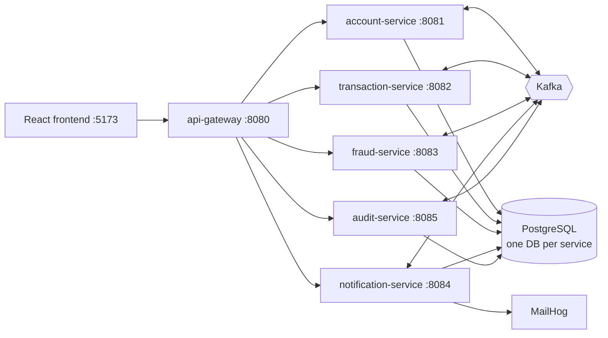

# Meridian Banking Platform

A learning-focused **banking backend built with Spring Boot microservices**. Customers open
accounts and move money (deposit, withdraw, transfer). Every transaction goes through an
**event-driven saga** on Kafka: fraud check → balance update → notification → audit.

It demonstrates patterns used in real fintech systems:

- API gateway with JWT login, and JWT re-validation in every service
- Database per service (PostgreSQL + Flyway)
- Kafka events with idempotent consumers and dead-letter topics
- **Transactional outbox** for reliable event publishing
- **Orchestrated saga** for money movement, with timeouts
- Rule-based fraud detection with a human review queue
- Immutable audit log, email notifications, Prometheus/Grafana metrics
- React frontend (customer + admin UI)

## Architecture



```
client ─► api-gateway (JWT) ─► account | transaction | fraud | notification | audit
                                   │          │          │          │           │
                                   └──────────┴── Kafka (banking.*.events) ─────┘
                                   each service ─► its own PostgreSQL database
```

Transfer flow (asynchronous — the API returns `202 Accepted` immediately):

```
POST /transfer ─► transaction-service: PENDING ── TRANSACTION_INITIATED ──► fraud-service
                                                                               │
              ◄────────────── FRAUD_CLEARED / FRAUD_DETECTED ──────────────────┘
transaction-service: PROCESSING ── BALANCE_UPDATE_REQUESTED ──► account-service (debit + credit, atomic)
              ◄────────────── BALANCE_UPDATED / BALANCE_UPDATE_FAILED ─────────┘
transaction-service: COMPLETED / FAILED ── TRANSACTION_COMPLETED / FAILED ──► notification, audit
```

More: [system overview](docs/architecture/system-overview.md) ·
[saga](docs/architecture/saga-pattern.md) · [outbox](docs/architecture/outbox-pattern.md)

## Services

| Service | Port | Database | Responsibility |
|---------|------|----------|----------------|
| api-gateway | 8080 | – | Login (issues JWT), routing, auth filter, CORS, circuit breakers, trace ids, system health |
| account-service | 8081 | `accounts_db` | Accounts, status (ACTIVE / FROZEN / CLOSED), balances and holds; applies debits/credits |
| transaction-service | 8082 | `transactions_db` | Deposit / withdraw / transfer API, history, **saga orchestrator**, saga timeouts |
| fraud-service | 8083 | `fraud_db` | Rule-based risk scoring, fraud alerts, admin review |
| notification-service | 8084 | `notifications_db` | Email (SMTP + Thymeleaf), simulated SMS/push, retries |
| audit-service | 8085 | `audit_db` | Immutable audit log of all account, transaction and fraud events |
| common-library | – | – | Shared DTOs (`ApiResponse`, `PagedResponse`), `ErrorCode`, `BaseEvent`, JWT utils, validators |

Infrastructure: PostgreSQL 5432, Kafka 9092 (+ ZooKeeper), Redis 6379, MailHog 1025/8025,
Kafka UI 8090, Prometheus 9090, Grafana 3000, OpenTelemetry collector 4317/4318.

## Tech stack

| Area | Technology |
|------|------------|
| Language | Java 21 |
| Framework | Spring Boot 3.3, Spring Cloud 2023.0 (Gateway, Circuit Breaker) |
| Security | Spring Security, JWT (jjwt), method security |
| Data | PostgreSQL, Spring Data JPA / Hibernate, Flyway |
| Messaging | Apache Kafka (Confluent 7.6), Spring Kafka |
| Email | JavaMailSender, Thymeleaf templates, MailHog (local) |
| Observability | Spring Boot Actuator, Micrometer, Prometheus, Grafana, OpenTelemetry (optional) |
| Build | Maven multi-module, Lombok |
| Frontend | React 18, Vite, Tailwind CSS |
| Runtime | Docker, Docker Compose |

## Quick start

### Prerequisites

- JDK 21+, Maven 3.9+, Docker Desktop (Compose v2), Node.js 18+ (for the frontend)

### Option A — everything in Docker

```bash
docker compose -f docker/docker-compose.yml up --build -d
docker compose -f docker/docker-compose.yml ps     # wait until all services are healthy
```

### Option B — infrastructure in Docker, services from Maven / IDE

```bash
docker compose -f docker/docker-compose.dev.yml up -d   # Postgres, Kafka, Redis, MailHog, ...
mvn clean install -DskipTests                           # build common-library + services

# one terminal per service
mvn -pl api-gateway spring-boot:run
mvn -pl account-service spring-boot:run -Dspring-boot.run.profiles=dev
mvn -pl transaction-service spring-boot:run -Dspring-boot.run.profiles=dev
mvn -pl fraud-service spring-boot:run -Dspring-boot.run.profiles=dev
mvn -pl notification-service spring-boot:run -Dspring-boot.run.profiles=dev
mvn -pl audit-service spring-boot:run -Dspring-boot.run.profiles=dev
```

### Frontend

```bash
cd frontend
npm install
npm run dev        # http://localhost:5173
```

Full guide and troubleshooting: [docs/deployment/local-setup.md](docs/deployment/local-setup.md).

### Useful URLs

| What | URL |
|------|-----|
| API gateway | http://localhost:8080 |
| Frontend | http://localhost:5173 |
| MailHog (emails) | http://localhost:8025 |
| Kafka UI | http://localhost:8090 |
| Prometheus | http://localhost:9090 |
| Grafana | http://localhost:3000 (admin / admin) |
| Health of a service | http://localhost:8081/actuator/health |

## Demo users

| Username | Password | User id | Role |
|----------|----------|---------|------|
| `rahul` | `password` | CUST-1001 | Customer (Rahul Sharma) |
| `priya` | `password` | CUST-1002 | Customer (Priya Patel) |
| `admin` | `admin123` | ADMIN-1 | Admin + customer (Devon Ellis) |

Demo credentials for local use only.

## Example flow with curl

The examples use [`jq`](https://jqlang.github.io/jq/) to pick values out of JSON responses. All
responses are wrapped as `{"data": ...}` on success or `{"error": {...}}` on failure.

```bash
GW=http://localhost:8080

# 1. Log in as Rahul and Priya
RAHUL=$(curl -s -X POST $GW/api/v1/auth/login -H "Content-Type: application/json" \
  -d '{"username":"rahul","password":"password"}' | jq -r .data.accessToken)
PRIYA=$(curl -s -X POST $GW/api/v1/auth/login -H "Content-Type: application/json" \
  -d '{"username":"priya","password":"password"}' | jq -r .data.accessToken)

# 2. Each opens an account (Rahul with an initial deposit)
SRC=$(curl -s -X POST $GW/api/v1/accounts \
  -H "Authorization: Bearer $RAHUL" -H "Content-Type: application/json" \
  -d '{"customerName":"Rahul Sharma","customerEmail":"rahul.sharma@example.com","accountType":"SAVINGS","currency":"INR","initialDeposit":10000}' \
  | jq -r .data.id)
DST=$(curl -s -X POST $GW/api/v1/accounts \
  -H "Authorization: Bearer $PRIYA" -H "Content-Type: application/json" \
  -d '{"customerName":"Priya Patel","customerEmail":"priya.patel@example.com","accountType":"SAVINGS","currency":"INR"}' \
  | jq -r .data.id)

# 3. Rahul transfers 1500 INR to Priya  -> 202 Accepted, status PENDING
TXN=$(curl -s -X POST $GW/api/v1/transactions/transfer \
  -H "Authorization: Bearer $RAHUL" -H "Content-Type: application/json" \
  -H "Idempotency-Key: $(uuidgen 2>/dev/null || date +%s%N)" \
  -d "{\"sourceAccountId\":\"$SRC\",\"destinationAccountId\":\"$DST\",\"amount\":1500,\"currency\":\"INR\",\"description\":\"Rent share\"}" \
  | jq -r .data.id)

# 4. Poll the status (a few seconds later: COMPLETED)
curl -s $GW/api/v1/transactions/$TXN/status -H "Authorization: Bearer $RAHUL" | jq

# 5. Check the balance
curl -s $GW/api/v1/accounts/$SRC/balance -H "Authorization: Bearer $RAHUL" | jq .data
```

Try the fraud flow: open an account with a larger `initialDeposit` (e.g. 300000), then transfer more
than 100000 with header `X-Client-Country: US` → AmountThresholdRule (+40) + GeographicRule (+25) =
risk score 65 (HIGH) → decision REVIEW → transaction goes to `UNDER_REVIEW`. Log in as `admin`, list
`GET /api/v1/fraud/alerts?status=OPEN` and approve with
`POST /api/v1/fraud/alerts/{id}/review` `{"decision":"APPROVE"}`.

API specs (OpenAPI 3): [docs/api-contracts](docs/api-contracts/).

## Project structure

```
banking-platform/
├── pom.xml                    parent POM (Spring Boot 3.3, Spring Cloud 2023.0, Java 21)
├── common-library/            shared DTOs, errors, events, JWT, validation, base exception handler
├── api-gateway/               Spring Cloud Gateway (WebFlux)
├── account-service/           ┐
├── transaction-service/       │ servlet services: controller / service / repository / entity /
├── fraud-service/             │ event / security / config, Flyway migrations in
├── notification-service/      │ src/main/resources/db/migration
├── audit-service/             ┘
├── frontend/                  React + Vite customer & admin UI
├── docker/                    docker-compose.yml (full stack), docker-compose.dev.yml (infra only),
│                              docker-compose.test.yml, image configs (postgres, kafka, grafana, ...)
├── infrastructure/            Kafka topic definitions & schemas, observability config,
│                              Postgres seeds, security policies
└── docs/                      architecture, ADRs, API contracts, events, database, deployment,
                               runbooks, security
```

## Documentation

| Topic | Documents |
|-------|-----------|
| Architecture | [System overview](docs/architecture/system-overview.md) · [Microservices design](docs/architecture/microservices-design.md) · [Event-driven design](docs/architecture/event-driven-design.md) · [Outbox](docs/architecture/outbox-pattern.md) · [Saga](docs/architecture/saga-pattern.md) |
| Decisions | [ADR index](docs/adr/README.md) |
| APIs | [OpenAPI specs](docs/api-contracts/) · [Versioning policy](docs/api-contracts/api-versioning-policy.md) |
| Events | [Event catalog](docs/events/event-catalog.md) · [Topic design](docs/events/topic-design.md) · [DLT management](docs/events/dlq-management.md) · [Schema evolution](docs/events/schema-evolution-policy.md) |
| Database | [Schema overview](docs/database/schema-overview.md) · [Indexing](docs/database/indexing-strategy.md) · [Migrations](docs/database/migration-strategy.md) · [Retention](docs/database/data-retention-policy.md) |
| Deployment | [Local setup](docs/deployment/local-setup.md) · [Environment config](docs/deployment/environment-config.md) · [CI/CD](docs/deployment/ci-cd-pipeline.md) · [Rollout](docs/deployment/rollout-strategy.md) |
| Operations | [Incident response](docs/runbooks/incident-response.md) · [Stuck saga](docs/runbooks/saga-stuck-recovery.md) · [Outbox backlog](docs/runbooks/outbox-backlog-recovery.md) · [Consumer lag](docs/runbooks/kafka-consumer-lag.md) · [DLT reprocessing](docs/runbooks/dlq-reprocessing.md) · [DB failover](docs/runbooks/database-failover.md) |
| Security | [Security model](docs/security/security-model.md) · [Threat model](docs/security/threat-model.md) · [Secrets](docs/security/secret-management.md) · [Compliance notes](docs/security/compliance-notes.md) |

## Running the tests

```bash
mvn verify                       # all modules
mvn -pl fraud-service verify     # one module
```

Tests do not need Docker, Kafka or Postgres (Mockito, `@WebMvcTest`, H2).

## Disclaimer

This is a learning project. It is not a real bank and must not be used with real money or real
personal data.
