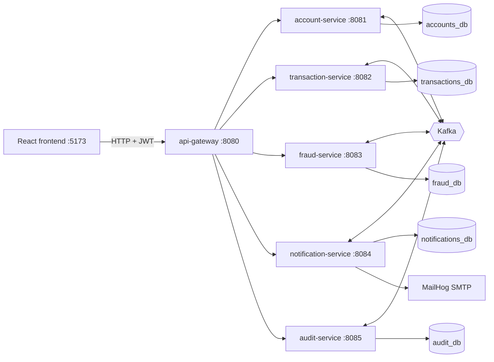

# Meridian Banking Platform

A banking backend built as **Spring Boot microservices**, with a React frontend. Customers open
accounts and move money (deposit, withdraw, transfer). Every money movement goes through an
**event-driven saga** on Kafka: fraud check → balance update → notification → audit.

This README is the complete reference: architecture, every service and class package, every REST
endpoint, every Kafka event, every database table and column, every config value, and how to run
and test everything. Deeper write-ups live in [`docs/`](docs/).

> Learning project. Not a real bank. Do not use with real money or real personal data.

---

## Table of contents

1. [What the platform does](#1-what-the-platform-does)
2. [Architecture](#2-architecture)
3. [Tech stack](#3-tech-stack)
4. [Repository structure](#4-repository-structure)
5. [Quick start](#5-quick-start)
6. [Security and authentication](#6-security-and-authentication)
7. [API conventions (responses, errors, paging)](#7-api-conventions)
8. [REST API reference](#8-rest-api-reference)
9. [Kafka: topics and events](#9-kafka-topics-and-events)
10. [The transfer saga, step by step](#10-the-transfer-saga-step-by-step)
11. [Outbox pattern and idempotency](#11-outbox-pattern-and-idempotency)
12. [Fraud rules](#12-fraud-rules)
13. [Notifications](#13-notifications)
14. [Audit log](#14-audit-log)
15. [Database reference (every table)](#15-database-reference)
16. [Module internals (every package)](#16-module-internals)
17. [Configuration and environment variables](#17-configuration-and-environment-variables)
18. [Docker and infrastructure](#18-docker-and-infrastructure)
19. [Observability](#19-observability)
20. [Frontend](#20-frontend)
21. [Testing](#21-testing)
22. [End-to-end walkthrough with curl](#22-end-to-end-walkthrough-with-curl)
23. [Known limitations](#23-known-limitations)
24. [Troubleshooting](#24-troubleshooting)
25. [Further documentation](#25-further-documentation)

---

## 1. What the platform does

| Capability | Where |
|---|---|
| Log in, get a JWT | api-gateway |
| Open / view / update / freeze / unfreeze / close accounts | account-service |
| See balances, hold (reserve) and release funds | account-service |
| Deposit, withdraw, transfer (asynchronous, returns `202 Accepted`) | transaction-service |
| Track every transaction status change and the saga state | transaction-service |
| Score every transaction for fraud, queue risky ones for human review | fraud-service |
| Send email (real SMTP) and SMS/push (simulated) for account and transaction events | notification-service |
| Keep an append-only audit trail of every event in the system | audit-service |
| Customer + admin web UI | frontend |

Design patterns used:

- **API gateway** with JWT login; every service **re-validates the JWT** (defense in depth).
- **Database per service**: one PostgreSQL instance, one database per service, schema owned by Flyway.
- **Event-driven** communication over Kafka (JSON messages, keyed by aggregate id).
- **Transactional outbox** so a DB change and its event can never get out of sync.
- **Orchestrated saga** (transaction-service is the orchestrator) with timeouts.
- **Idempotent consumers** and **dead-letter topics** (`<topic>.DLT`).
- **Rule-based fraud engine** with a manual review queue.
- **Immutable audit log** enforced by a database trigger.

---

## 2. Architecture



| Service | Port | Database | Kafka consumer group | Responsibility |
|---|---|---|---|---|
| api-gateway | 8080 | – | – | Login (issues JWT), routing, JWT filter, CORS, circuit breakers, trace ids, aggregated health |
| account-service | 8081 | `accounts_db` | `account-service` | Accounts, status, balances and holds; applies debits/credits for the saga |
| transaction-service | 8082 | `transactions_db` | `transaction-service` | Deposit/withdraw/transfer API, history, **saga orchestrator**, saga timeouts |
| fraud-service | 8083 | `fraud_db` | `fraud-service` | Risk scoring, fraud alerts, admin review |
| notification-service | 8084 | `notifications_db` | `notification-service` | Email (SMTP + Thymeleaf), simulated SMS/push, retries |
| audit-service | 8085 | `audit_db` | `audit-service` | Immutable audit log of every account, transaction and fraud event |
| common-library | – | – | – | Shared DTOs, error codes, base event, JWT, validators, utilities |

### Who talks to whom

- **Synchronous (HTTP):** only *client → gateway → service*. Services never call each other over HTTP.
- **Asynchronous (Kafka):** everything between services.

| Service | Publishes to | Consumes from |
|---|---|---|
| account-service | `banking.account.events` (via outbox) | `banking.transaction.events` (only `BALANCE_UPDATE_REQUESTED`) |
| transaction-service | `banking.transaction.events` (via outbox) | `banking.fraud.events`, `banking.account.events` (`BALANCE_UPDATED`, `BALANCE_UPDATE_FAILED`) |
| fraud-service | `banking.fraud.events` (direct) | `banking.transaction.events` (only `TRANSACTION_INITIATED`) |
| notification-service | – | `banking.account.events`, `banking.transaction.events`, `banking.notification.events` |
| audit-service | – | `banking.account.events`, `banking.transaction.events`, `banking.fraud.events` (everything) |

### Life of one HTTP request

```
browser
  │  Authorization: Bearer <jwt>
  ▼
api-gateway
  1. TraceIdPropagationFilter  → reuse or create X-Trace-Id (also returned in the response)
  2. RequestLoggingFilter      → logs method, path, status, duration
  3. CORS                      → allows http://localhost:5173 by default
  4. JwtAuthenticationFilter   → validates token (except /api/v1/auth/login and /actuator/**),
                                 strips any client-sent X-User-Id / X-User-Roles,
                                 adds X-User-Id and X-User-Roles from the token
  5. Route + circuit breaker   → forwards to the service; on failure → /fallback/{service} (503)
  ▼
service (e.g. account-service)
  6. JwtAuthenticationFilter   → validates the same token again, puts AuthenticatedUser in SecurityContext
  7. SecurityConfig            → authenticated required; @PreAuthorize("hasRole('ADMIN')") on admin endpoints
  8. Controller → Service → Repository → PostgreSQL
  9. GlobalExceptionHandler    → any exception becomes an ApiResponse error JSON
```

---

## 3. Tech stack

| Area | Technology / version |
|---|---|
| Language | Java 21 (builds also on JDK 23–26, see [§21](#21-testing)) |
| Framework | Spring Boot 3.3.4, Spring Cloud 2023.0.3 |
| Gateway | Spring Cloud Gateway (WebFlux / reactive), Resilience4j circuit breaker |
| Security | Spring Security, JWT via jjwt 0.12.6 (HS256), BCrypt for demo passwords |
| Persistence | PostgreSQL 16, Spring Data JPA / Hibernate, Flyway (`ddl-auto: validate`) |
| Messaging | Apache Kafka (Confluent 7.6.1) + ZooKeeper 3.8.4, Spring Kafka |
| Mapping | MapStruct 1.5.5, Lombok 1.18.48 |
| Email | JavaMailSender + Thymeleaf, MailHog locally |
| Observability | Actuator, Micrometer + Prometheus 2.53, Grafana 11.1, OpenTelemetry Collector 0.105 (optional) |
| Cache (present, optional) | Redis 7.2 (not required to start) |
| Frontend | React 18, Vite 5, Tailwind CSS 3, react-router 6 |
| Tests | JUnit 5, Mockito, AssertJ, `@WebMvcTest`, WebTestClient, embedded PostgreSQL (zonky) |
| Build / run | Maven multi-module, Docker, Docker Compose |

---

## 4. Repository structure

```
banking-platform/
├── pom.xml                      parent POM: modules, versions, compiler/Lombok setup
├── common-library/              shared code used by every service (jar, not runnable)
├── api-gateway/                 Spring Cloud Gateway (reactive)
├── account-service/
├── transaction-service/
├── fraud-service/
├── notification-service/
├── audit-service/
│     each service:
│     ├── Dockerfile             multi-stage build (context = repo root)
│     ├── pom.xml
│     └── src/
│         ├── main/java/com/banking/<service>/
│         │     config/ controller/ dto/ entity/ event/ exception/ mapper/
│         │     producer/ consumer/ repository/ security/ service/ util/ validation/
│         ├── main/resources/
│         │     application.yml, application-dev.yml
│         │     db/migration/V1__*.sql          (Flyway)
│         └── test/java/...                     (unit, web-slice and schema tests)
├── frontend/                    React + Vite customer & admin UI
├── docker/
│   ├── docker-compose.yml       full stack (infra + 6 services)
│   ├── docker-compose.dev.yml   infra only (run services from IDE/Maven)
│   ├── docker-compose.test.yml  minimal Postgres + Kafka for integration testing
│   ├── .env.example
│   └── postgresql/ kafka/ zookeeper/ kafka-ui/ prometheus/ grafana/ otel-collector/
├── infrastructure/
│   ├── kafka/schemas/           JSON Schemas for key events
│   ├── kafka/topics/            topics.yaml + create-topics.sh
│   ├── observability/           Prometheus recording rules, OTel sampling, Grafana notes
│   ├── postgresql/              migration notes + dev seed data
│   └── security/policies/       JWT and secret-rotation policies
└── docs/                        architecture, ADRs, OpenAPI contracts, events, database,
                                 deployment, runbooks, security
```

---

## 5. Quick start

### Prerequisites

- JDK 21 or newer, Maven 3.9+
- Docker Desktop with Compose v2 (for Postgres, Kafka, etc.)
- Node.js 18+ (frontend)

### Option A: everything in Docker

```bash
cd docker
cp .env.example .env            # optional: change ports/passwords
docker compose up -d --build    # first build downloads Maven deps, takes a while
docker compose ps               # wait until every container is "healthy"
```

### Option B: infra in Docker, services from Maven/IDE (best for development)

```bash
docker compose -f docker/docker-compose.dev.yml up -d   # Postgres, Kafka, ZooKeeper, Redis, MailHog, ...
mvn clean install -DskipTests                           # builds common-library + all services

# one terminal per service (the "dev" profile turns on SQL logging and DEBUG logs)
mvn -pl api-gateway          spring-boot:run
mvn -pl account-service      spring-boot:run -Dspring-boot.run.profiles=dev
mvn -pl transaction-service  spring-boot:run -Dspring-boot.run.profiles=dev
mvn -pl fraud-service        spring-boot:run -Dspring-boot.run.profiles=dev
mvn -pl notification-service spring-boot:run -Dspring-boot.run.profiles=dev
mvn -pl audit-service        spring-boot:run -Dspring-boot.run.profiles=dev
```

Every service runs its Flyway migration on startup, so the tables are created automatically. The
databases themselves are created by `docker/postgresql/init/02-create-schemas.sh`.

### Option C: deploy on AWS (one EC2 server)

`docker/docker-compose.prod.yml` is a smaller stack for one 4 GB server. Kafka runs in KRaft mode,
there are no monitoring tools, and nginx serves the React app and forwards `/api` on port 80.
On an Ubuntu 24.04 EC2 instance:

```bash
git clone https://github.com/prabuddh148/banking-platform.git && cd banking-platform
bash infrastructure/aws/setup-ec2.sh     # installs Docker, adds swap, creates secrets, builds, starts
```

Google Cloud instead? `bash infrastructure/gcp/gcp.sh up` from your PC creates the VM and installs
everything: [docs/deployment/gcp.md](docs/deployment/gcp.md).

AWS step-by-step guide (account, budget alert, instance, security group, costs, cleanup):
[docs/deployment/aws-ec2.md](docs/deployment/aws-ec2.md).

### Frontend

```bash
cd frontend
npm install
npm run dev                     # http://localhost:5173  (proxies /api to http://localhost:8080)
# no backend? run with mock data instead:
VITE_USE_MOCK=true npm run dev
```

### Optional seed data

After the services have started once (so the tables exist):

```bash
docker exec -i banking-postgres psql -U banking -d postgres < infrastructure/postgresql/seeds/dev-seed-data.sql
```

Creates two accounts for `CUST-1001` (Rahul) and one for `CUST-1002` (Priya). It writes directly to
the databases, so no Kafka events are produced (no welcome email, no audit row).

### Useful URLs

| What | URL |
|---|---|
| API gateway | http://localhost:8080 |
| Frontend | http://localhost:5173 |
| MailHog (see sent emails) | http://localhost:8025 |
| Kafka UI | http://localhost:8090 |
| Prometheus | http://localhost:9090 |
| Grafana | http://localhost:3000 (admin / admin) |
| Health of one service | http://localhost:8081/actuator/health (8081–8085) |
| Prometheus metrics of one service | http://localhost:8081/actuator/prometheus |

### Demo users

Defined in `api-gateway/src/main/resources/application.yml` (`gateway.auth.users`, BCrypt hashed).

| Username | Password | userId | Roles | Name / email |
|---|---|---|---|---|
| `rahul` | `password` | `CUST-1001` | `ROLE_CUSTOMER` | Rahul Sharma, rahul.sharma@example.com |
| `priya` | `password` | `CUST-1002` | `ROLE_CUSTOMER` | Priya Patel, priya.patel@example.com |
| `admin` | `admin123` | `ADMIN-1` | `ROLE_ADMIN`, `ROLE_CUSTOMER` | Devon Ellis, admin@meridian.bank |

---

## 6. Security and authentication

### Login and the token

`POST /api/v1/auth/login` on the gateway checks the username/password against the demo users and
returns a JWT signed with **HS256** using `jwt.secret` (env `JWT_SECRET`, at least 32 bytes).
Validity is `jwt.expiry` (env `JWT_EXPIRY`, default `PT1H` = 1 hour).

JWT contents:

| Claim | Example | Meaning |
|---|---|---|
| `iss` | `banking-platform` | Issuer; tokens with another issuer are rejected |
| `sub` | `rahul` | Username |
| `userId` | `CUST-1001` | Owner id; accounts and transactions are tied to this |
| `roles` | `["ROLE_CUSTOMER"]` | `ROLE_CUSTOMER` and/or `ROLE_ADMIN` |
| `email`, `name` | | Profile info |
| `jti`, `iat`, `exp` | | Token id, issued-at, expiry |

All services share the same secret, so each one can validate the token itself
(`common-library` → `security/JwtUtil`).

### Headers

| Header | Direction | Purpose |
|---|---|---|
| `Authorization: Bearer <jwt>` | client → gateway → service | Authentication |
| `X-Trace-Id` | both ways | Created by the gateway if missing; returned in every response |
| `X-User-Id`, `X-User-Roles` | gateway → service | Set by the gateway from the token; client-sent values are removed |
| `Idempotency-Key` | client → transaction-service | Makes deposit/withdraw/transfer safe to retry |
| `X-Client-Country` | client → transaction-service | Country code used by the fraud GeographicRule |

### Authorization rules

- Public: `POST /api/v1/auth/login`, `/actuator/health/**`, `/actuator/info`, `/actuator/prometheus`.
- Everything else needs a valid token, otherwise **401** (`UNAUTHORIZED`, `INVALID_TOKEN` or `TOKEN_EXPIRED`).
- Admin-only endpoints use `@PreAuthorize("hasRole('ADMIN')")` → **403** `FORBIDDEN` for customers.
- Ownership: a customer can only see/change their own data. `CurrentUser.requireOwnerOrAdmin(ownerId)`
  throws `FORBIDDEN` otherwise. Admins can see everything.
- Services are stateless (`SessionCreationPolicy.STATELESS`), CSRF is off (token auth, no cookies).

---

## 7. API conventions

### Response envelope (`common-library` → `dto/ApiResponse`)

Every response has **either** `data` **or** `error`. The other one is left out of the JSON.

```json
{ "data": { "id": "6c1e...", "accountNumber": "ACC4821930457", "balance": 10000.00 } }
```

```json
{
  "error": {
    "message": "Request validation failed",
    "code": "VALIDATION_ERROR",
    "status": 400,
    "details": { "amount": "amount must be greater than 0" },
    "timestamp": "2026-11-21T10:15:30Z"
  }
}
```

`details` is only present for validation errors (field → message).

### Paging (`dto/PagedResponse`)

List endpoints take `page` (0-based, default `0`) and `size` (default `20`, max `100`) and return:

```json
{ "data": { "content": [ ... ], "page": 0, "size": 20, "totalElements": 57, "totalPages": 3, "last": false } }
```

### Formats

- Money: JSON numbers, 2 decimals (`BigDecimal`, scale 2, `HALF_EVEN`). Never floating point in code.
- Currencies: `INR` (default), `USD`, `EUR`, `GBP` (`@ValidCurrency`).
- Times: ISO-8601 UTC (`2026-11-21T10:15:30Z`). Stored as `TIMESTAMP WITH TIME ZONE`.
- Ids: UUID strings. Account numbers look like `ACC` + 10 digits (e.g. `ACC4821930457`).
  Transaction references look like `TXN` + `yyyyMMdd` (IST) + 8 random `A-Z0-9` (e.g. `TXN20261121K7Q2M9XA`).

### Error codes (`common-library` → `exception/ErrorCode`)

| Code | HTTP | Default message |
|---|---|---|
| `INTERNAL_ERROR` | 500 | Internal server error |
| `BAD_REQUEST` | 400 | Bad request |
| `VALIDATION_ERROR` | 400 | Request validation failed |
| `NOT_FOUND` | 404 | Resource not found |
| `UNAUTHORIZED` | 401 | Authentication required |
| `FORBIDDEN` | 403 | You are not allowed to perform this action |
| `CONFLICT` | 409 | Request conflicts with current state |
| `ACCOUNT_NOT_FOUND` | 404 | Account not found |
| `ACCOUNT_FROZEN` | 409 | Account is frozen |
| `ACCOUNT_CLOSED` | 409 | Account is closed |
| `INSUFFICIENT_FUNDS` | 409 | Insufficient funds |
| `CURRENCY_MISMATCH` | 400 | Currency does not match the account currency |
| `TRANSACTION_NOT_FOUND` | 404 | Transaction not found |
| `TRANSACTION_FAILED` | 422 | Transaction failed |
| `INVALID_TRANSACTION` | 400 | Invalid transaction |
| `DUPLICATE_TRANSACTION` | 409 | Duplicate transaction |
| `FRAUD_BLOCKED` | 403 | Transaction blocked by fraud checks |
| `FRAUD_ALERT_NOT_FOUND` | 404 | Fraud alert not found |
| `NOTIFICATION_NOT_FOUND` | 404 | Notification not found |
| `NOTIFICATION_DELIVERY_FAILED` | 502 | Notification delivery failed |
| `AUDIT_LOG_NOT_FOUND` | 404 | Audit log not found |
| `INVALID_TOKEN` | 401 | Invalid authentication token |
| `TOKEN_EXPIRED` | 401 | Authentication token has expired |
| `INVALID_CREDENTIALS` | 401 | Invalid username or password |
| `SERVICE_UNAVAILABLE` | 503 | Service temporarily unavailable |

How exceptions are mapped (`web/BaseGlobalExceptionHandler`, extended by each service):

| Exception | Result |
|---|---|
| `BankingException` (and subclasses like `AccountNotFoundException`) | its `ErrorCode` |
| `MethodArgumentNotValidException`, `ConstraintViolationException` | 400 `VALIDATION_ERROR` + `details` |
| Unreadable JSON, wrong param type, missing param, `IllegalArgumentException` | 400 `BAD_REQUEST` |
| `AccessDeniedException` / `AuthorizationDeniedException` | 403 `FORBIDDEN` |
| Optimistic-lock failure (concurrent update) | 409 `CONFLICT` |
| `DataIntegrityViolationException` (e.g. duplicate idempotency key race) | 409 |
| Unknown URL | 404 `NOT_FOUND` |
| Anything else | 500 `INTERNAL_ERROR` (logged with stack trace) |

---

## 8. REST API reference

All paths go through the gateway (`http://localhost:8080`). "Admin" = needs `ROLE_ADMIN`.
OpenAPI 3 specs: [`docs/api-contracts/`](docs/api-contracts/).

### 8.1 api-gateway

| Method | Path | Auth | Description |
|---|---|---|---|
| POST | `/api/v1/auth/login` | public | Body `{username*, password*}` → `{accessToken, tokenType:"Bearer", expiresIn (seconds), user}` |
| GET | `/api/v1/auth/me` | token | Current user `{userId, username, name, email, roles}` |
| GET | `/api/v1/system/health` | admin | Calls every service's `/actuator/health` (2 s timeout, in parallel) → `[{service, url, status: UP/DOWN, latencyMs}]` |
| any | `/fallback/{service}` | token | Used by circuit breakers → 503 `SERVICE_UNAVAILABLE` |

Routes (from `gateway.services` in `application.yml`):

| Path | Forwarded to | Env override |
|---|---|---|
| `/api/v1/accounts/**` | `http://localhost:8081` | `ACCOUNT_SERVICE_URL` |
| `/api/v1/transactions/**` | `http://localhost:8082` | `TRANSACTION_SERVICE_URL` |
| `/api/v1/fraud/**` | `http://localhost:8083` | `FRAUD_SERVICE_URL` |
| `/api/v1/notifications/**` | `http://localhost:8084` | `NOTIFICATION_SERVICE_URL` |
| `/api/v1/audit/**` | `http://localhost:8085` | `AUDIT_SERVICE_URL` |

Circuit breaker per route: 20-call sliding window, opens at 50% failures, stays open 15 s, call
timeout `gateway.circuit-breaker.timeout` (default 10 s, env `CIRCUIT_BREAKER_TIMEOUT`).

### 8.2 account-service (`/api/v1/accounts`)

| Method | Path | Auth | Description |
|---|---|---|---|
| POST | `/api/v1/accounts` | token | Open an account → **201** `AccountResponse` |
| GET | `/api/v1/accounts` | token | Customer: own accounts. Admin: all, filters `customerId`, `status`. Paged `AccountSummaryResponse` |
| GET | `/api/v1/accounts/{id}` | owner/admin | `AccountResponse` |
| GET | `/api/v1/accounts/number/{accountNumber}` | owner/admin | `AccountResponse` |
| PATCH | `/api/v1/accounts/{id}` | owner/admin | Update contact details |
| POST | `/api/v1/accounts/{id}/freeze` | admin | ACTIVE → FROZEN. Optional body `{reason}` |
| POST | `/api/v1/accounts/{id}/unfreeze` | admin | FROZEN → ACTIVE. Optional body `{reason}` |
| POST | `/api/v1/accounts/{id}/close` | owner/admin | → CLOSED (balance must be 0). Optional body `{reason}` |
| GET | `/api/v1/accounts/{id}/balance` | owner/admin | `AccountBalanceResponse` |
| POST | `/api/v1/accounts/{id}/balance/reserve` | admin | Put a hold on funds `{amount*, transactionId*}` |
| POST | `/api/v1/accounts/{id}/balance/release` | admin | Release a hold `{amount*, transactionId*}` (exact amount) |

**CreateAccountRequest**

| Field | Rules |
|---|---|
| `customerName` | required, max 150 |
| `customerEmail` | required, valid email |
| `customerPhone` | optional, 7–15 digits, may start with `+` |
| `accountType` | required: `SAVINGS`, `CURRENT`, `FIXED_DEPOSIT` |
| `currency` | optional, default `INR`; `INR`/`USD`/`EUR`/`GBP` |
| `initialDeposit` | optional, ≥ 0, max 2 decimals, default 0. Set as the opening balance (no saga) |
| `customerId` | optional, max 64; **only used when an admin opens an account for someone**, otherwise the caller's `userId` |

**UpdateAccountRequest**: `customerName` (1–150), `customerEmail` (email), `customerPhone` (same pattern). All optional.

**ReserveBalanceRequest**: `amount` (required, ≥ 0.01, 2 decimals), `transactionId` (required, max 64).

**AccountResponse**: `id, accountNumber, customerId, customerName, customerEmail, customerPhone,
accountType, status, currency, balance, availableBalance, createdAt, updatedAt`

**AccountSummaryResponse**: `id, accountNumber, accountType, status, currency, balance, customerName`

**AccountBalanceResponse**: `accountId, accountNumber, ledgerBalance, availableBalance, reservedAmount, currency, lastUpdated`
(`availableBalance = ledgerBalance − reservedAmount`)

Status rules: freeze only from ACTIVE, unfreeze only from FROZEN, close needs balance 0 and no
active holds; a CLOSED account can't change again. Every change writes an `account_status_history`
row and an `ACCOUNT_STATUS_CHANGED` event. Opening writes a history row (`null → ACTIVE`) and
`ACCOUNT_CREATED`.

### 8.3 transaction-service (`/api/v1/transactions`)

| Method | Path | Auth | Description |
|---|---|---|---|
| POST | `/api/v1/transactions/deposit` | token | `DepositRequest` → **202** `TransactionResponse` (status `PENDING`) |
| POST | `/api/v1/transactions/withdraw` | token | Same body as deposit → **202** |
| POST | `/api/v1/transactions/transfer` | token | `TransferRequest` → **202** |
| GET | `/api/v1/transactions/{id}` | initiator/admin | `TransactionResponse` |
| GET | `/api/v1/transactions/reference/{reference}` | initiator/admin | `TransactionResponse` |
| GET | `/api/v1/transactions` | token | Customer: transactions they initiated (optionally `accountId`). Admin: all, filters `accountId`, `status`, `type`. Paged |
| GET | `/api/v1/transactions/{id}/status` | initiator/admin | `TransactionStatusResponse` (with full history) |
| GET | `/api/v1/transactions/{id}/saga` | admin | `SagaStateResponse` |

Optional headers on the POSTs: `Idempotency-Key`, `X-Client-Country`.

**DepositRequest** (also used for withdraw): `accountId` (required, max 64), `amount` (required,
> 0, ≤ 10,000,000, 2 decimals), `currency` (optional, default INR), `description` (max 255).

**TransferRequest**: `sourceAccountId`*, `destinationAccountId`* (must differ from source),
`amount`* (same rules), `currency`, `description`.

**TransactionResponse**: `id, reference, transactionType (DEPOSIT|WITHDRAWAL|TRANSFER), status
(PENDING|UNDER_REVIEW|PROCESSING|COMPLETED|FAILED), sourceAccountId, destinationAccountId, amount,
currency, description, initiatedBy, failureReason, failureCode, riskScore, createdAt, updatedAt, completedAt`

**TransactionStatusResponse**: `transactionId, reference, status, failureReason, history: [{fromStatus, toStatus, reason, changedAt}]`

**SagaStateResponse**: `sagaId, transactionId, status, currentStep, retryCount, failureReason, startedAt, updatedAt, completedAt`

Idempotency: the same `Idempotency-Key` from the same user returns the existing transaction instead
of creating a new one (unique index on `(initiated_by, idempotency_key)`; a race returns 409).

### 8.4 fraud-service (`/api/v1/fraud`)

| Method | Path | Auth | Description |
|---|---|---|---|
| POST | `/api/v1/fraud/check` | admin | Dry run of the rules (nothing saved). `FraudCheckRequest` → `FraudDecisionResponse` |
| GET | `/api/v1/fraud/alerts` | admin | Filters `status` (OPEN/APPROVED/REJECTED), `riskLevel`. Paged `FraudAlertResponse` |
| GET | `/api/v1/fraud/alerts/{id}` | admin | `FraudAlertResponse` |
| POST | `/api/v1/fraud/alerts/{id}/review` | admin | `{decision*: APPROVE|REJECT, notes (≤2000)}`; only OPEN alerts |
| GET | `/api/v1/fraud/decisions/transaction/{transactionId}` | initiator/admin | `FraudDecisionResponse` |
| GET | `/api/v1/fraud/stats` | admin | `{totalAlerts, alertsByStatus, totalDecisions, decisionsByRiskLevel}` |

**FraudCheckRequest**: `transactionId, accountId, amount* (> 0), currency, transactionType, clientCountry (≤ 8)`

**FraudDecisionResponse**: `transactionId, riskScore (0–100), riskLevel, decision (APPROVE|REVIEW|BLOCK), triggeredRules, reason, evaluatedAt`

**FraudAlertResponse**: `id, transactionId, accountId, amount, currency, riskScore, riskLevel,
triggeredRules, status, reason, reviewedBy, reviewNotes, createdAt, reviewedAt`

Review: APPROVE → alert `APPROVED`, publishes `FRAUD_CLEARED` (with `reviewedBy`). REJECT → alert
`REJECTED`, publishes `FRAUD_DETECTED` with decision `BLOCK`. The stored decision is updated too.

### 8.5 notification-service (`/api/v1/notifications`)

| Method | Path | Auth | Description |
|---|---|---|---|
| GET | `/api/v1/notifications` | token | Customer: own (recipientId = userId). Admin: all, filters `recipientId`, `status`, `channel`. Paged |
| GET | `/api/v1/notifications/{id}` | owner/admin | `NotificationResponse` |
| POST | `/api/v1/notifications/{id}/retry` | admin | Re-send a `FAILED` notification (409 if not FAILED) |
| PATCH | `/api/v1/notifications/{id}/read` | owner only | Sets `readAt` |

**NotificationResponse**: `id, recipientId, channel (EMAIL|SMS|PUSH), type, status (PENDING|SENT|FAILED),
subject, message, recipient (masked email/phone), attempts, errorMessage, createdAt, sentAt, readAt`

### 8.6 audit-service (`/api/v1/audit`, all admin)

| Method | Path | Description |
|---|---|---|
| GET | `/api/v1/audit/logs` | Filters `eventType`, `aggregateId`, `actor`, `severity`, `from`, `to` (ISO instants). Newest first. Paged |
| GET | `/api/v1/audit/logs/{id}` | One log |
| GET | `/api/v1/audit/logs/aggregate/{aggregateId}` | Everything about one account/transaction, oldest first |
| GET | `/api/v1/audit/logs/actor/{actor}` | Everything a user did, newest first |
| GET | `/api/v1/audit/logs/correlation/{correlationId}` | Every event of one business flow, oldest first |
| GET | `/api/v1/audit/summary?from&to` | `{totalEvents, countsByEventType, countsBySeverity, from, to}`; defaults: last 30 days; `from > to` → 400 |

**AuditLogResponse**: `id, eventId, eventType, aggregateId, aggregateType, actor, action, severity,
sourceService, correlationId, details (JSON object, PII masked), occurredAt, recordedAt`

### 8.7 Actuator (every service, direct port)

`/actuator/health`, `/actuator/info`, `/actuator/prometheus` are public. `/actuator/metrics` is
exposed too. Redis and mail health checks are disabled so a missing Redis/MailHog does not mark the
service DOWN.

---

## 9. Kafka: topics and events

### Topics

| Topic | Producer | Partitions | DLT |
|---|---|---|---|
| `banking.account.events` | account-service | 3 | `banking.account.events.DLT` |
| `banking.transaction.events` | transaction-service | 3 | `banking.transaction.events.DLT` |
| `banking.fraud.events` | fraud-service | 3 | `banking.fraud.events.DLT` |
| `banking.notification.events` | any service | 3 | `banking.notification.events.DLT` |

Created by `infrastructure/kafka/topics/create-topics.sh` (the `kafka-init` container) and also by
`NewTopic` beans in the services. Retention: 7 days (domain topics), 3 days (notification), 30 days (DLTs).

### Message format

- Key: `aggregateId` (account id or transaction id), so all events of one aggregate go to the same
  partition and stay in order.
- Value: JSON string (`StringSerializer` / `StringDeserializer`). Consumers read the `eventType`
  field and ignore event types they don't handle, and unknown fields (`ignoreUnknown`).
- Producer: `acks=all`, `enable.idempotence=true`. Consumer: `auto-offset-reset=earliest`, `ack-mode=record`.

### Common fields (`common-library` → `event/BaseEvent`)

| Field | Meaning |
|---|---|
| `eventId` | UUID of this event (used for de-duplication) |
| `eventType` | One of the types below |
| `aggregateId` | Id the event is about |
| `occurredAt` | ISO time |
| `correlationId` | Same for all events of one flow (e.g. one transfer) |
| `source` | Producing service name |
| `schemaVersion` | Currently `1` |

### Event catalog

| Event | Topic | aggregateId | Extra fields |
|---|---|---|---|
| `ACCOUNT_CREATED` | account | accountId | `accountId, accountNumber, customerId, customerName, customerEmail, customerPhone, accountType, currency, initialBalance` |
| `ACCOUNT_STATUS_CHANGED` | account | accountId | `accountId, accountNumber, customerId, customerEmail, customerName, previousStatus, newStatus, reason, changedBy` |
| `BALANCE_UPDATED` | account | transactionId | `transactionId, transactionType, sourceAccountId, destinationAccountId, amount, currency, sourceBalanceAfter, destinationBalanceAfter` |
| `BALANCE_UPDATE_FAILED` | account | transactionId | `transactionId, reason, errorCode` (`INSUFFICIENT_FUNDS`, `ACCOUNT_FROZEN`, `ACCOUNT_CLOSED`, `ACCOUNT_NOT_FOUND`, `CURRENCY_MISMATCH`, `FORBIDDEN`, `INVALID_TRANSACTION`) |
| `TRANSACTION_INITIATED` | transaction | transactionId | `transactionId, reference, transactionType, sourceAccountId, destinationAccountId, amount, currency, initiatedBy, description, clientCountry` |
| `BALANCE_UPDATE_REQUESTED` | transaction | transactionId | `transactionId, reference, transactionType, sourceAccountId, destinationAccountId, amount, currency, initiatedBy` |
| `TRANSACTION_COMPLETED` | transaction | transactionId | `transactionId, reference, transactionType, sourceAccountId, destinationAccountId, amount, currency, initiatedBy, description, completedAt` |
| `TRANSACTION_FAILED` | transaction | transactionId | `transactionId, reference, transactionType, sourceAccountId, destinationAccountId, amount, currency, initiatedBy, failureReason, failureCode` |
| `FRAUD_CLEARED` | fraud | transactionId | `transactionId, riskScore, riskLevel, decision (always APPROVE), triggeredRules, reason, alertId, reviewedBy` |
| `FRAUD_DETECTED` | fraud | transactionId | same fields; `decision` is `REVIEW` (wait for admin) or `BLOCK` (fail) |
| `NOTIFICATION_REQUESTED` | notification | recipientId | `recipientId, recipientEmail, recipientPhone, channel, notificationType, subject, message` |

Example (`TRANSACTION_INITIATED`):

```json
{
  "eventId": "0b8f6a5e-7c1d-4f7e-9a51-2f0f2b7f1c11",
  "eventType": "TRANSACTION_INITIATED",
  "aggregateId": "5d2b0c8e-3f4a-4c55-8e0e-1a2b3c4d5e6f",
  "occurredAt": "2026-11-21T10:15:30.123Z",
  "correlationId": "c0ffee00-1111-2222-3333-444455556666",
  "source": "transaction-service",
  "schemaVersion": 1,
  "transactionId": "5d2b0c8e-3f4a-4c55-8e0e-1a2b3c4d5e6f",
  "reference": "TXN20261121K7Q2M9XA",
  "transactionType": "TRANSFER",
  "sourceAccountId": "9a7c...",
  "destinationAccountId": "4e1d...",
  "amount": 1500.00,
  "currency": "INR",
  "initiatedBy": "CUST-1001",
  "description": "Rent share",
  "clientCountry": "IN"
}
```

JSON Schemas for `ACCOUNT_CREATED`, the fraud decision and `TRANSACTION_INITIATED` are in
[`infrastructure/kafka/schemas/`](infrastructure/kafka/schemas/). Full catalog with examples:
[`docs/events/event-catalog.md`](docs/events/event-catalog.md).

### Error handling

Every consumer uses `DefaultErrorHandler` + `DeadLetterPublishingRecoverer`:

1. A failing message is retried **3 times, 1 second apart** (`FixedBackOff(1000, 3)`).
2. Then it is sent to `<topic>.DLT` and the consumer moves on.
3. Messages that can never succeed (invalid JSON, missing `eventId`/`transactionId`) skip the
   retries and go straight to the DLT.

How to inspect and replay DLT messages: [`docs/runbooks/dlq-reprocessing.md`](docs/runbooks/dlq-reprocessing.md).

---

## 10. The transfer saga, step by step

transaction-service is the **orchestrator**: all state changes live in
`saga/TransactionSagaOrchestrator`. Each step updates `transactions`, `saga_states`,
`transaction_status_history`, `transaction_audit` and (when needed) `outbox_events` in **one DB transaction**.

Example: Rahul sends ₹1,500 to Priya.

| # | Who | What happens | Transaction status | Saga status |
|---|---|---|---|---|
| 1 | client → transaction-service | `POST /transfer` validated, row saved, outbox `TRANSACTION_INITIATED`, **202** returned | `PENDING` | `AWAITING_FRAUD_CHECK` (step `FRAUD_CHECK`) |
| 2 | fraud-service | Consumes `TRANSACTION_INITIATED`, runs 4 rules, saves `fraud_decisions` (+ `fraud_alerts` if REVIEW/BLOCK), publishes `FRAUD_CLEARED` or `FRAUD_DETECTED` | | |
| 3a | transaction-service | `FRAUD_CLEARED` (APPROVE) → stores `riskScore`, outbox `BALANCE_UPDATE_REQUESTED` | `PROCESSING` | `AWAITING_BALANCE_UPDATE` (step `BALANCE_UPDATE`) |
| 3b | transaction-service | `FRAUD_DETECTED` + REVIEW → waits for an admin | `UNDER_REVIEW` | `AWAITING_REVIEW` (step `MANUAL_REVIEW`) |
| 3c | transaction-service | `FRAUD_DETECTED` + BLOCK → outbox `TRANSACTION_FAILED` (`failureCode=FRAUD_BLOCKED`) | `FAILED` | `FAILED` |
| 4 | account-service | Consumes `BALANCE_UPDATE_REQUESTED`: locks both balance rows (`SELECT … FOR UPDATE`, ordered by id to avoid deadlocks), checks accounts exist, are ACTIVE, currency matches, source is owned by `initiatedBy`, enough available funds → debit + credit in one DB transaction → outbox `BALANCE_UPDATED`; on a business failure nothing changes → outbox `BALANCE_UPDATE_FAILED` | | |
| 5a | transaction-service | `BALANCE_UPDATED` → outbox `TRANSACTION_COMPLETED` | `COMPLETED` | `COMPLETED` (step `COMPLETION`) |
| 5b | transaction-service | `BALANCE_UPDATE_FAILED` → outbox `TRANSACTION_FAILED` with the error code | `FAILED` | `FAILED` |
| 6 | notification-service | Emails/SMS to the sender (and "money received" to Priya) | | |
| 7 | audit-service | Records every event above | | |

Deposits skip the source checks; withdrawals skip the destination.

**Admin review:** an admin approves/rejects the alert in fraud-service → `FRAUD_CLEARED` /
`FRAUD_DETECTED(BLOCK)` → step 3a / 3c continues.

**Compensation:** account-service applies debit and credit atomically, so there is never a half-done
transfer to undo. A failure simply marks the transaction `FAILED`.

**Timeouts:** a scheduled job (every `saga.timeout-check-interval-ms`, default 60 s) fails sagas
stuck in `AWAITING_FRAUD_CHECK` or `AWAITING_BALANCE_UPDATE` for longer than `saga.timeout-minutes`
(default 15; 5 in the `dev` profile) with `failureCode=TRANSACTION_FAILED`, reason "Saga timed out".
`AWAITING_REVIEW` never times out. If a late `BALANCE_UPDATED` arrives for an already-failed
transaction, the service logs `RECONCILIATION NEEDED` at ERROR level and writes an audit row (the
status is not changed). See [`docs/runbooks/saga-stuck-recovery.md`](docs/runbooks/saga-stuck-recovery.md).

```
PENDING ──fraud APPROVE──► PROCESSING ──BALANCE_UPDATED──► COMPLETED
   │  └──fraud REVIEW──► UNDER_REVIEW ──admin APPROVE──► PROCESSING
   │                          └──────admin REJECT──► FAILED
   ├──fraud BLOCK──► FAILED
   └──timeout──► FAILED            PROCESSING ──BALANCE_UPDATE_FAILED / timeout──► FAILED
```

---

## 11. Outbox pattern and idempotency

### Outbox (account-service, transaction-service)

1. The service saves the business change **and** a row in `outbox_events` (status `PENDING`) in the
   same DB transaction. Either both are saved or neither is.
2. `producer/OutboxEventRelay` runs every `outbox.relay.interval-ms` (default 2000 ms), takes up to
   100 `PENDING` rows (oldest first, `FOR UPDATE SKIP LOCKED` in account-service so two instances
   don't send the same row), and sends each with `kafkaTemplate.send(topic, key, payload).get(10 s)`.
3. Success → `PUBLISHED` + `published_at`. Failure → `attempts + 1`, `last_error`; after **5**
   attempts → `FAILED`. transaction-service stops the batch at the first failure to keep order.
4. Gauge `outbox.events.pending` (and `outbox.events.failed` in account-service) shows the backlog.

fraud-service publishes directly with `KafkaTemplate` inside its DB transaction (a failed send rolls
back the decision so the event is retried). notification-service and audit-service don't publish.

Recovery steps: [`docs/runbooks/outbox-backlog-recovery.md`](docs/runbooks/outbox-backlog-recovery.md).

### Idempotency (safe re-delivery)

Kafka can deliver a message more than once. Each consumer makes duplicates harmless:

| Service | How |
|---|---|
| account-service | `processed_transactions` (PK `transaction_id`): a balance update for a transaction is applied once |
| transaction-service | `processed_events` (PK `event_id`) + state checks (an event that doesn't fit the current state is ignored with a warning) |
| fraud-service | UNIQUE `fraud_decisions.transaction_id` + `existsByTransactionId` check |
| notification-service | `processed_events` (PK `event_id`) |
| audit-service | UNIQUE `audit_logs.event_id` |
| HTTP API | `Idempotency-Key` header on deposit/withdraw/transfer |

---

## 12. Fraud rules

All rules are Spring beans implementing `rules/FraudRule`; `service/RuleEngineService` runs them all,
`util/RiskScoreCalculator` sums the scores. A rule that throws is logged and skipped. Thresholds are
in `fraud.rules.*` (`config/FraudRulesConfig`).

| Rule | Triggers when | Score |
|---|---|---|
| `AmountThresholdRule` | amount > 100,000 / > 500,000 | +40 / +70 |
| `VelocityRule` | more than 5 transactions on the same account in 10 minutes (stored decisions + this one) | +30 |
| `GeographicRule` | `clientCountry` is set and not in the allowed list (`[IN]`) | +25 |
| `PatternAnomalyRule` | amount > 5× the account's average of the last 20 decisions (needs ≥ 3) | +20 |
| `PatternAnomalyRule` | transaction between 00:00 and 05:00 IST | +10 |

The account tracked is the source account (destination for deposits). Score is capped at 100.

| Score | Risk level | Decision | Effect |
|---|---|---|---|
| 0–29 | LOW | APPROVE | `FRAUD_CLEARED` |
| 30–59 | MEDIUM | APPROVE | `FRAUD_CLEARED` |
| 60–79 | HIGH | REVIEW | alert `OPEN`, `FRAUD_DETECTED(REVIEW)`, transaction `UNDER_REVIEW` |
| 80–100 | CRITICAL | BLOCK | alert saved as `REJECTED` by `SYSTEM`, `FRAUD_DETECTED(BLOCK)`, transaction `FAILED` |

Example: ₹1,50,000 transfer with `X-Client-Country: US` → 40 + 25 = 65 → HIGH → manual review.

---

## 13. Notifications

| Event | Who gets notified | Channels | Type / template |
|---|---|---|---|
| `ACCOUNT_CREATED` | account holder (contact saved to `account_contacts`) | EMAIL | `WELCOME` |
| `ACCOUNT_STATUS_CHANGED` | account holder (contact refreshed) | EMAIL | `ACCOUNT_STATUS_CHANGED` |
| `TRANSACTION_COMPLETED` | holder of the main account (source; destination for deposits) | EMAIL + SMS | `TRANSACTION_COMPLETED` |
| `TRANSACTION_COMPLETED` (transfer) | receiver | EMAIL + SMS | `MONEY_RECEIVED` |
| `TRANSACTION_FAILED` | holder of the main account | EMAIL + SMS | `TRANSACTION_FAILED` |
| `NOTIFICATION_REQUESTED` | `recipientId` (missing email/phone filled from contacts) | as requested | `GENERAL` (`generic` template) |

- Email: `JavaMailSender` → SMTP `${MAIL_HOST:localhost}:${MAIL_PORT:1025}` (MailHog), HTML from
  Thymeleaf templates in `notification-service/src/main/resources/templates/email/`
  (`welcome`, `account-status-changed`, `transaction-completed`, `transaction-failed`,
  `money-received`, `generic`). A broken template falls back to plain text. From:
  `no-reply@meridian.bank` ("Meridian Bank").
- SMS and push are **simulated**: they are logged, not sent. SMS text is at most 160 characters.
- A channel with no address on file is skipped.
- Amounts are formatted with `MoneyUtil.format` (₹1,500.00); account numbers are masked (`*********0457`).
- A delivery error never breaks the Kafka consumer: the notification is saved as `FAILED` with
  `error_message`. A scheduled job (every 60 s, first run after 30 s) retries `FAILED` ones while
  `attempts < 3` (total attempts including the first). Admins can force a retry via the API.

---

## 14. Audit log

- One row per event from the account, transaction and fraud topics (every event type).
- **Actor** = first non-blank of `initiatedBy`, `changedBy`, `reviewedBy`, `customerId`, else `system`.
- **aggregateType**: ACCOUNT (`ACCOUNT_*`), TRANSACTION (`TRANSACTION_*`, `BALANCE_*`), FRAUD
  (`FRAUD_*`), NOTIFICATION; unknown event types are stored as `UNKNOWN` with the original name in
  `raw_event_type`.
- **Severity**: `FRAUD_DETECTED` → CRITICAL if BLOCK, WARNING if REVIEW;
  `TRANSACTION_FAILED`, `BALANCE_UPDATE_FAILED`, `ACCOUNT_STATUS_CHANGED` → WARNING; everything else → INFO.
- `action` is a readable sentence built by `util/AuditLogFormatter`; `details` is the event payload
  as JSON with any field whose name contains `email`, `phone` or `accountNumber` masked.
- **Immutable**: database triggers reject `UPDATE`, `DELETE` and `TRUNCATE` on `audit_logs`.

---

## 15. Database reference

One PostgreSQL server, five databases (created by `docker/postgresql/init/02-create-schemas.sh`,
owner `banking`). `01-create-extensions.sql` installs `pgcrypto`, `uuid-ossp`, `pg_trgm` into
`template1`. Each service creates its own tables with Flyway (`V1__*.sql`); Hibernate only
**validates** that entities match (`ddl-auto: validate`). No foreign keys cross databases; ids from
other services are plain `VARCHAR`/`UUID` values.

### 15.1 `accounts_db` (account-service)

**`accounts`**

| Column | Type | Notes |
|---|---|---|
| `id` | UUID | PK |
| `account_number` | VARCHAR(13) | NOT NULL, UNIQUE (`uk_accounts_account_number`), `ACC` + 10 digits |
| `customer_id` | VARCHAR(64) | NOT NULL, owner (`userId` from JWT) |
| `customer_name` | VARCHAR(150) | NOT NULL |
| `customer_email` | VARCHAR(255) | NOT NULL |
| `customer_phone` | VARCHAR(20) | |
| `account_type` | VARCHAR(20) | NOT NULL, CHECK `SAVINGS`/`CURRENT`/`FIXED_DEPOSIT` |
| `status` | VARCHAR(20) | NOT NULL, CHECK `ACTIVE`/`FROZEN`/`CLOSED` |
| `currency` | VARCHAR(3) | NOT NULL |
| `created_at`, `updated_at` | TIMESTAMPTZ | NOT NULL |
| `version` | BIGINT | NOT NULL DEFAULT 0, optimistic locking |

Indexes: `idx_accounts_customer_id (customer_id)`, `idx_accounts_status (status)`.

**`account_balances`** (1:1 with accounts)

| Column | Type | Notes |
|---|---|---|
| `account_id` | UUID | PK, FK → `accounts(id)` |
| `ledger_balance` | NUMERIC(19,2) | NOT NULL DEFAULT 0, CHECK ≥ 0 |
| `reserved_amount` | NUMERIC(19,2) | NOT NULL DEFAULT 0, CHECK ≥ 0 and ≤ `ledger_balance` |
| `currency` | VARCHAR(3) | NOT NULL |
| `last_updated` | TIMESTAMPTZ | NOT NULL |
| `version` | BIGINT | NOT NULL DEFAULT 0 |

**`account_status_history`**

| Column | Type | Notes |
|---|---|---|
| `id` | UUID | PK |
| `account_id` | UUID | NOT NULL, FK → `accounts(id)` |
| `previous_status` | VARCHAR(20) | null for the opening row |
| `new_status` | VARCHAR(20) | NOT NULL |
| `reason` | VARCHAR(255) | |
| `changed_by` | VARCHAR(64) | NOT NULL |
| `changed_at` | TIMESTAMPTZ | NOT NULL |

Index: `idx_status_history_account (account_id, changed_at)`.

**`balance_reservations`** (holds)

| Column | Type | Notes |
|---|---|---|
| `id` | UUID | PK |
| `account_id` | UUID | NOT NULL, FK → `accounts(id)` |
| `transaction_id` | VARCHAR(64) | NOT NULL; UNIQUE `(account_id, transaction_id)` |
| `amount` | NUMERIC(19,2) | NOT NULL, CHECK > 0 |
| `status` | VARCHAR(20) | NOT NULL, CHECK `ACTIVE`/`RELEASED`/`CONSUMED` |
| `created_at` | TIMESTAMPTZ | NOT NULL |
| `closed_at` | TIMESTAMPTZ | when released/consumed |

A saga debit that finds an `ACTIVE` hold for the same transaction consumes it.

**`processed_transactions`** (idempotency of balance updates)

| Column | Type | Notes |
|---|---|---|
| `transaction_id` | VARCHAR(64) | PK |
| `transaction_type` | VARCHAR(20) | |
| `outcome` | VARCHAR(20) | NOT NULL, `SUCCEEDED`/`FAILED` |
| `error_code` | VARCHAR(50) | for failures |
| `source_account_id`, `destination_account_id` | UUID | indexed |
| `amount` | NUMERIC(19,2) | |
| `source_balance_after`, `destination_balance_after` | NUMERIC(19,2) | |
| `processed_at` | TIMESTAMPTZ | NOT NULL |

Indexes: `idx_processed_source`, `idx_processed_destination`.

**`outbox_events`**

| Column | Type | Notes |
|---|---|---|
| `id` | UUID | PK |
| `aggregate_type` | VARCHAR(50) | NOT NULL |
| `aggregate_id` | VARCHAR(64) | NOT NULL, used as Kafka key |
| `event_type` | VARCHAR(50) | NOT NULL |
| `topic` | VARCHAR(100) | NOT NULL |
| `payload` | TEXT | NOT NULL, the JSON message |
| `status` | VARCHAR(20) | NOT NULL, `PENDING`/`PUBLISHED`/`FAILED` |
| `attempts` | INTEGER | NOT NULL DEFAULT 0 |
| `last_error` | TEXT | |
| `created_at` | TIMESTAMPTZ | NOT NULL |
| `published_at` | TIMESTAMPTZ | |

Index: `idx_outbox_pending (status, created_at)`.

### 15.2 `transactions_db` (transaction-service)

**`transactions`**

| Column | Type | Notes |
|---|---|---|
| `id` | UUID | PK (also the saga's transactionId) |
| `reference` | VARCHAR(32) | NOT NULL, UNIQUE |
| `transaction_type` | VARCHAR(20) | NOT NULL, CHECK `DEPOSIT`/`WITHDRAWAL`/`TRANSFER` |
| `status` | VARCHAR(20) | NOT NULL, CHECK `PENDING`/`UNDER_REVIEW`/`PROCESSING`/`COMPLETED`/`FAILED` |
| `source_account_id` | VARCHAR(64) | null for deposits; indexed |
| `destination_account_id` | VARCHAR(64) | null for withdrawals; indexed |
| `amount` | NUMERIC(19,2) | NOT NULL, CHECK > 0 |
| `currency` | VARCHAR(3) | NOT NULL |
| `description` | VARCHAR(255) | |
| `initiated_by` | VARCHAR(64) | NOT NULL, userId |
| `idempotency_key` | VARCHAR(100) | partial UNIQUE `(initiated_by, idempotency_key) WHERE idempotency_key IS NOT NULL` |
| `client_country` | VARCHAR(8) | from `X-Client-Country` |
| `correlation_id` | VARCHAR(64) | NOT NULL, carried on every event of this flow |
| `failure_reason` | VARCHAR(500) | |
| `failure_code` | VARCHAR(50) | ErrorCode name, e.g. `FRAUD_BLOCKED`, `INSUFFICIENT_FUNDS` |
| `risk_score` | INTEGER | from fraud-service |
| `created_at`, `updated_at` | TIMESTAMPTZ(6) | NOT NULL |
| `completed_at` | TIMESTAMPTZ(6) | |
| `version` | BIGINT | optimistic locking |

Indexes: `uk_transactions_idempotency`, `idx_transactions_initiated_by (initiated_by, created_at DESC)`,
`idx_transactions_source`, `idx_transactions_destination`, `idx_transactions_status`.

**`transaction_status_history`**: `id BIGSERIAL PK`, `transaction_id UUID NOT NULL FK`,
`from_status`, `to_status NOT NULL`, `reason VARCHAR(500)`, `changed_at NOT NULL`.
Index `(transaction_id, changed_at)`.

**`transaction_audit`** (saga action log inside this service): `id BIGSERIAL PK`,
`transaction_id UUID NOT NULL FK`, `action VARCHAR(50) NOT NULL`, `actor VARCHAR(64) NOT NULL`,
`details VARCHAR(1000)`, `created_at NOT NULL`. Index `(transaction_id, created_at)`.

**`saga_states`**

| Column | Type | Notes |
|---|---|---|
| `id` | UUID | PK (sagaId) |
| `transaction_id` | UUID | NOT NULL, UNIQUE, FK → `transactions(id)` |
| `status` | VARCHAR(30) | `AWAITING_FRAUD_CHECK`/`AWAITING_REVIEW`/`AWAITING_BALANCE_UPDATE`/`COMPLETED`/`FAILED` |
| `current_step` | VARCHAR(30) | `FRAUD_CHECK`/`MANUAL_REVIEW`/`BALANCE_UPDATE`/`COMPLETION` (stays on the failed step when failed) |
| `retry_count` | INTEGER | NOT NULL DEFAULT 0 |
| `failure_reason` | VARCHAR(500) | |
| `started_at`, `updated_at` | TIMESTAMPTZ(6) | NOT NULL |
| `completed_at` | TIMESTAMPTZ(6) | |
| `version` | BIGINT | |

Index `idx_saga_states_status_updated (status, updated_at)`: used by the timeout job.

**`outbox_events`**: same columns as in accounts_db (`last_error` is VARCHAR(1000)).
Index `(status, created_at)`.

**`processed_events`**: `event_id VARCHAR(64) PK`, `event_type VARCHAR(50) NOT NULL`, `processed_at NOT NULL`.

### 15.3 `fraud_db` (fraud-service)

**`fraud_decisions`** (one per evaluated transaction; also the history used by Velocity and Pattern rules)

| Column | Type | Notes |
|---|---|---|
| `id` | UUID | PK |
| `transaction_id` | VARCHAR(64) | NOT NULL, UNIQUE |
| `account_id` | VARCHAR(64) | tracked account |
| `transaction_type` | VARCHAR(20) | |
| `amount` | NUMERIC(19,2) | NOT NULL |
| `currency` | VARCHAR(3) | |
| `initiated_by` | VARCHAR(64) | used for customer access checks |
| `client_country` | VARCHAR(8) | |
| `risk_score` | INTEGER | NOT NULL, CHECK 0–100 |
| `risk_level` | VARCHAR(20) | NOT NULL; indexed |
| `decision` | VARCHAR(20) | NOT NULL, `APPROVE`/`REVIEW`/`BLOCK` (updated after admin review) |
| `triggered_rules` | TEXT | comma-separated rule names |
| `reason` | TEXT | |
| `correlation_id` | VARCHAR(64) | |
| `reviewed_by` | VARCHAR(64) | |
| `evaluated_at` | TIMESTAMPTZ | NOT NULL |

Indexes: `idx_fraud_decisions_account_time (account_id, evaluated_at DESC)`, `idx_fraud_decisions_risk_level`.

**`fraud_alerts`** (only for REVIEW/BLOCK)

| Column | Type | Notes |
|---|---|---|
| `id` | UUID | PK |
| `transaction_id` | VARCHAR(64) | NOT NULL, UNIQUE |
| `account_id` | VARCHAR(64) | |
| `amount` | NUMERIC(19,2) | NOT NULL |
| `currency` | VARCHAR(3) | |
| `risk_score` | INTEGER | NOT NULL |
| `risk_level` | VARCHAR(20) | NOT NULL; indexed |
| `triggered_rules` | TEXT | |
| `status` | VARCHAR(20) | NOT NULL, `OPEN`/`APPROVED`/`REJECTED` |
| `reason` | TEXT | |
| `reviewed_by` | VARCHAR(64) | admin userId, or `SYSTEM` for auto-blocks |
| `review_notes` | TEXT | |
| `created_at` | TIMESTAMPTZ | NOT NULL |
| `reviewed_at` | TIMESTAMPTZ | |
| `version` | BIGINT | optimistic locking (two admins reviewing at once → 409) |

Indexes: `idx_fraud_alerts_status (status, created_at DESC)`, `idx_fraud_alerts_risk_level`.

### 15.4 `notifications_db` (notification-service)

**`notifications`**

| Column | Type | Notes |
|---|---|---|
| `id` | UUID | PK |
| `recipient_id` | VARCHAR(64) | NOT NULL, customerId |
| `channel` | VARCHAR(16) | NOT NULL, CHECK `EMAIL`/`SMS`/`PUSH` |
| `type` | VARCHAR(40) | NOT NULL, `WELCOME`/`ACCOUNT_STATUS_CHANGED`/`TRANSACTION_COMPLETED`/`TRANSACTION_FAILED`/`MONEY_RECEIVED`/`GENERAL` |
| `status` | VARCHAR(16) | NOT NULL, CHECK `PENDING`/`SENT`/`FAILED` |
| `recipient_address` | VARCHAR(255) | email or phone (masked in the API) |
| `subject` | VARCHAR(255) | |
| `message` | TEXT | plain text / SMS text |
| `html_body` | TEXT | rendered email HTML |
| `reference_id` | VARCHAR(64) | e.g. transactionId; indexed |
| `event_id` | VARCHAR(64) | source event |
| `attempts` | INTEGER | NOT NULL DEFAULT 0 |
| `error_message` | VARCHAR(1000) | |
| `created_at`, `updated_at` | TIMESTAMPTZ | NOT NULL |
| `last_attempt_at`, `sent_at`, `read_at` | TIMESTAMPTZ | |

Indexes: `(recipient_id, created_at DESC)`, `(status, attempts)` (retry job), `(reference_id)`.

**`account_contacts`** (local copy of contact data from account events)

| Column | Type | Notes |
|---|---|---|
| `account_id` | VARCHAR(64) | PK |
| `account_number` | VARCHAR(32) | |
| `customer_id` | VARCHAR(64) | NOT NULL; indexed |
| `customer_name` | VARCHAR(200) | |
| `email` | VARCHAR(255) | |
| `phone` | VARCHAR(32) | |
| `created_at`, `updated_at` | TIMESTAMPTZ | NOT NULL |

**`processed_events`**: `event_id VARCHAR(64) PK`, `event_type VARCHAR(64) NOT NULL`, `processed_at NOT NULL`.

### 15.5 `audit_db` (audit-service)

**`audit_logs`**

| Column | Type | Notes |
|---|---|---|
| `id` | UUID | PK |
| `event_id` | VARCHAR(100) | NOT NULL, UNIQUE (`uk_audit_logs_event_id`) |
| `event_type` | VARCHAR(50) | NOT NULL |
| `raw_event_type` | VARCHAR(100) | original name when `event_type` is `UNKNOWN` |
| `aggregate_id` | VARCHAR(100) | |
| `aggregate_type` | VARCHAR(30) | NOT NULL |
| `actor` | VARCHAR(100) | NOT NULL |
| `action` | VARCHAR(500) | NOT NULL, readable sentence |
| `severity` | VARCHAR(20) | NOT NULL, CHECK `INFO`/`WARNING`/`CRITICAL` |
| `source_service` | VARCHAR(100) | |
| `correlation_id` | VARCHAR(100) | |
| `details` | TEXT | masked JSON payload |
| `occurred_at` | TIMESTAMPTZ | NOT NULL, from the event |
| `recorded_at` | TIMESTAMPTZ | NOT NULL DEFAULT NOW() |

Indexes: `occurred_at DESC`, `(aggregate_id, occurred_at)`, `(actor, occurred_at DESC)`,
`(correlation_id, occurred_at)`, `(event_type, occurred_at DESC)`, `(severity, occurred_at DESC)`.

Triggers: `trg_audit_logs_no_update_delete` (BEFORE UPDATE OR DELETE, per row) and
`trg_audit_logs_no_truncate` (BEFORE TRUNCATE) call `reject_audit_log_modification()`, which raises
`audit_logs is append-only: <op> is not allowed`.

Every service also has Flyway's own `flyway_schema_history` table. More: [`docs/database/`](docs/database/).

---

## 16. Module internals

Every servlet service follows the same layering: **controller → service (interface + Impl) →
repository → entity**, with DTOs at the edge, MapStruct (or a hand-written mapper) in between,
Kafka in `consumer/` and `producer/`, and JWT in `security/`.

### common-library (`com.banking.common`)

| Package | Classes | What they do |
|---|---|---|
| `dto` | `ApiResponse`, `ErrorResponse`, `PagedResponse` | Response envelope, error body, page wrapper |
| `exception` | `ErrorCode`, `BankingException` | All error codes with HTTP status; the one unchecked exception everything extends |
| `event` | `EventType`, `BaseEvent` | Event names + topic (`EventType.Topics.*` constants), common event fields |
| `security` | `JwtUtil`, `AuthenticatedUser`, `CurrentUser`, `SecurityConstants` | Create/parse JWTs; logged-in user record; read current user / ownership checks; header, claim and role names |
| `util` | `MoneyUtil`, `DateTimeUtil`, `MaskingUtil` | BigDecimal math + ₹ formatting; UTC/IST helpers; masking of account numbers, emails, phones, cards |
| `validation` | `@ValidCurrency` + `CurrencyValidator`, `@ValidIban` + `IbanValidator` | Bean-validation annotations (IBAN uses mod-97) |
| `web` | `BaseGlobalExceptionHandler` | Exception → ApiResponse mapping, extended by every servlet service |

### account-service (`com.banking.account`)

| Package | Classes |
|---|---|
| root | `AccountServiceApplication` |
| `config` | `KafkaConsumerConfig` (error handler/DLT), `KafkaProducerConfig` (topics), `SchedulingConfig`, `SecurityConfig`, `OutboxMetricsConfig` (gauges) |
| `controller` | `AccountController`, `AccountBalanceController` |
| `service` | `AccountService`/`AccountServiceImpl` (lifecycle), `AccountBalanceService`/`AccountBalanceServiceImpl` (balances, holds, saga balance updates) |
| `consumer` | `TransactionCompletedConsumer`: listens on `banking.transaction.events` and handles **`BALANCE_UPDATE_REQUESTED`** (name kept from the original skeleton) |
| `producer` | `AccountEventProducer` (writes outbox rows), `OutboxEventRelay` (sends them) |
| `entity` | `Account`, `AccountBalance`, `AccountStatusHistory`, `BalanceReservation`, `ProcessedTransaction`, `OutboxEvent` + enums `AccountStatus`, `AccountType`, `ReservationStatus`, `BalanceUpdateOutcome`, `OutboxStatus`, `TransactionType` |
| `event` | `AccountCreatedEvent`, `AccountStatusChangedEvent`, `BalanceUpdateRequestedEvent` (in), `BalanceUpdatedEvent`, `BalanceUpdateFailedEvent`, `EventSources` |
| `repository` | `AccountRepository`, `AccountBalanceRepository` (pessimistic lock queries), `AccountStatusHistoryRepository`, `BalanceReservationRepository`, `ProcessedTransactionRepository`, `OutboxEventRepository` |
| `dto` | requests `CreateAccountRequest`, `UpdateAccountRequest`, `ReserveBalanceRequest`, `StatusChangeRequest`; responses `AccountResponse`, `AccountSummaryResponse`, `AccountBalanceResponse` |
| other | `mapper/AccountMapper` (MapStruct), `util/AccountNumberGenerator` (SecureRandom, retries on collision), `validation/AccountValidator`, `exception/*`, `security/JwtAuthenticationFilter`, `security/JwtTokenValidator` |

### transaction-service (`com.banking.transaction`)

| Package | Classes |
|---|---|
| root | `TransactionServiceApplication` |
| `config` | `JpaAuditingConfig`, `KafkaConsumerConfig`, `KafkaProducerConfig`, `SecurityConfig` |
| `controller` | `TransactionController` (create/list/get), `TransactionStatusController` (status, saga) |
| `service` | `TransactionService`/`TransactionServiceImpl` (validation, idempotency, creates PENDING + starts saga) |
| `saga` | `TransactionSagaOrchestrator` (every state transition + timeout job), `SagaStep` (enum) |
| `consumer` | `FraudDecisionConsumer` (fraud topic), `AccountResponseConsumer` (`BALANCE_UPDATED`/`BALANCE_UPDATE_FAILED`) |
| `producer` | `TransactionEventProducer` (outbox writes, `Propagation.MANDATORY`), `OutboxEventRelay`, `OutboxMetrics` |
| `entity` | `Transaction`, `TransactionStatusHistory`, `TransactionAudit`, `SagaState`, `OutboxEvent`, `ProcessedEvent` + enums `TransactionStatus`, `TransactionType`, `SagaStatus`, `OutboxStatus` |
| `event` | `TransactionInitiatedEvent`, `BalanceUpdateRequestedEvent`, `TransactionCompletedEvent`, `TransactionFailedEvent`, `FraudDecisionReceivedEvent`, `BalanceUpdatedEvent`, `BalanceUpdateFailedEvent`, `EventSources` |
| `repository` | `TransactionRepository`, `TransactionSpecifications` (list filters), `TransactionStatusHistoryRepository`, `TransactionAuditRepository`, `SagaStateRepository`, `OutboxEventRepository`, `ProcessedEventRepository` |
| other | `dto/*`, `mapper/TransactionMapper`, `util/TransactionReferenceGenerator`, `validation/TransactionValidator`, `exception/*`, `security/*` |

### fraud-service (`com.banking.fraud`)

| Package | Classes |
|---|---|
| root | `FraudServiceApplication` |
| `config` | `FraudRulesConfig` (`fraud.rules.*`), `KafkaConsumerConfig`, `KafkaProducerConfig`, `SecurityConfig` |
| `rules` | `FraudRule` (interface), `AmountThresholdRule`, `VelocityRule`, `GeographicRule`, `PatternAnomalyRule`, `RuleResult` (name, triggered, score, reason), `TransactionContext` (rule input) |
| `service` | `FraudDetectionService`/`FraudDetectionServiceImpl` (evaluate, save, publish, review), `RuleEngineService`, `FraudEvaluation` |
| `util` | `RiskScoreCalculator` (sum, cap, level, decision) |
| `consumer` / `producer` | `TransactionInitiatedConsumer` / `FraudDecisionProducer` |
| `entity` | `FraudDecision`, `FraudAlert`, `StringListConverter` + enums `RiskLevel`, `Decision`, `AlertStatus` |
| `event` | `FraudResultEvent` (shared parent), `FraudClearedEvent`, `FraudDetectedEvent`, `TransactionInitiatedEvent` (in) |
| other | `controller/FraudAlertController`, `dto/*` (incl. `FraudStatsResponse`), `mapper/FraudAlertMapper`, `repository/FraudAlertRepository`, `repository/FraudDecisionRepository`, `exception/*`, `security/*` |

### notification-service (`com.banking.notification`)

| Package | Classes |
|---|---|
| root | `NotificationServiceApplication` |
| `config` | `AsyncConfig` (scheduling + thread pool), `KafkaConsumerConfig`, `MailConfig` (`notification.mail.*`), `SecurityConfig` |
| `consumer` | `AccountEventConsumer`, `TransactionEventConsumer`, `NotificationEventConsumer` |
| `service` | `NotificationService`/`NotificationServiceImpl` (create, send, retry, queries), `NotificationSender` (interface), `EmailNotificationService`, `SmsNotificationService`, `PushNotificationService` |
| `template` | `NotificationTemplate` (enum), `EmailTemplateResolver` (Thymeleaf), `SmsTemplateResolver` |
| `util` | `NotificationChannelResolver` |
| `entity` | `Notification`, `AccountContact`, `ProcessedEvent` + enums `NotificationChannel`, `NotificationStatus`, `NotificationType` |
| `event` | `AccountCreatedEvent`, `AccountStatusChangedEvent`, `TransactionCompletedEvent`, `TransactionFailedEvent`, `NotificationRequestedEvent` |
| other | `controller/NotificationController`, `dto/NotificationCommand`, `dto/response/NotificationResponse`, `mapper/NotificationMapper` (hand-written, masks addresses), `repository/*`, `exception/*`, `security/*` |

### audit-service (`com.banking.audit`)

| Package | Classes |
|---|---|
| root | `AuditServiceApplication` |
| `config` | `JpaAuditingConfig`, `KafkaConsumerConfig`, `SecurityConfig` |
| `consumer` | `AccountEventConsumer`, `TransactionEventConsumer`, `FraudEventConsumer` |
| `service` | `AuditService`/`AuditServiceImpl` (`recordEvent`, queries incl. `getAuditLogsByActor`, summary, severity rules) |
| `util` | `AuditLogFormatter` (action text + masked details) |
| `entity` | `AuditLog` (immutable, no setters) + enums `AuditEventType`, `AuditSeverity` |
| `repository` | `AuditLogRepository` (query methods, Specification filters, GROUP BY counts) |
| other | `controller/AuditController`, `dto/response/*`, `mapper/AuditLogMapper`, `exception/GlobalExceptionHandler`, `security/*` |

### api-gateway (`com.banking.gateway`)

| Package | Classes |
|---|---|
| root | `ApiGatewayApplication` |
| `config` | `GatewayAppProperties` (`gateway.*`), `GatewayRouteConfig` (routes + circuit breakers), `CorsConfig`, `SecurityConfig` (reactive, permit-all; auth done by the JWT filter; password encoder for `{bcrypt}`/`{noop}`) |
| `filter` | `TraceIdPropagationFilter`, `RequestLoggingFilter`, `JwtAuthenticationFilter` (all `WebFilter`s so they also protect the gateway's own endpoints) |
| `auth` | `AuthController`, `AuthService`/`AuthServiceImpl`, `dto/LoginRequest`, `dto/LoginResponse`, `dto/UserResponse` |
| `health` | `SystemHealthController`, `SystemHealthService`/`SystemHealthServiceImpl` (WebClient), `ServiceHealthResponse` |
| `fallback` | `FallbackController` |
| `exception` | `GatewayException`, `GlobalExceptionHandler` (reactive `ErrorWebExceptionHandler`) |
| `util` | `JwtTokenUtil`, `RouteValidator` (open endpoints) |

The gateway is WebFlux, so its POM excludes `spring-boot-starter-web` / tomcat that come through
common-library.

---

## 17. Configuration and environment variables

All settings are in each module's `src/main/resources/application.yml` with env-var overrides.
`application-dev.yml` (profile `dev`) adds SQL logging and DEBUG logs for `com.banking`.

### Shared by the services

| Env var | Default | Used by |
|---|---|---|
| `SERVER_PORT` | 8080–8085 | all |
| `DB_HOST` / `DB_PORT` | `localhost` / `5432` | JPA services |
| `DB_NAME` | `accounts_db`, `transactions_db`, `fraud_db`, `notifications_db`, `audit_db` | JPA services |
| `DB_USERNAME` / `DB_PASSWORD` | `banking` / `banking` | JPA services |
| `DB_POOL_SIZE` | `10` | Hikari pool size |
| `KAFKA_BOOTSTRAP_SERVERS` | `localhost:9092` (`kafka:29092` inside Docker) | all except gateway |
| `REDIS_HOST` / `REDIS_PORT` | `localhost` / `6379` | account, transaction, fraud (optional) |
| `JWT_SECRET` | `change-me-dev-secret-key-at-least-32-bytes-long` | **all** (must be identical everywhere) |
| `JWT_EXPIRY` | `PT1H` | all |
| `TRACING_ENABLED` | `false` | all |

### Service-specific

| Env var / property | Default | Service | Meaning |
|---|---|---|---|
| `OUTBOX_RELAY_INTERVAL_MS` | `2000` | account, transaction | Outbox relay delay between runs |
| `SAGA_TIMEOUT_MINUTES` | `15` | transaction | Stuck-saga timeout |
| `SAGA_TIMEOUT_CHECK_INTERVAL_MS` | `60000` | transaction | How often the timeout job runs |
| `fraud.rules.*` | see [§12](#12-fraud-rules) | fraud | All thresholds and scores, risk-level boundaries (30/60/80), night window, time zone |
| `MAIL_HOST` / `MAIL_PORT` | `localhost` / `1025` | notification | SMTP server |
| `MAIL_USERNAME` / `MAIL_PASSWORD` | empty | notification | SMTP auth |
| `MAIL_SMTP_AUTH` / `MAIL_STARTTLS` | `false` / `false` | notification | SMTP options (timeouts 5 s) |
| `MAIL_FROM` / `MAIL_FROM_NAME` | `no-reply@meridian.bank` / `Meridian Bank` | notification | Sender |
| `NOTIFICATION_MAX_ATTEMPTS` | `3` | notification | Total delivery attempts |
| `NOTIFICATION_RETRY_INTERVAL_MS` | `60000` | notification | Retry job interval |
| `MAIL_HEALTH_ENABLED` | `false` | notification | Include SMTP in `/actuator/health` |
| `ACCOUNT_SERVICE_URL` … `AUDIT_SERVICE_URL` | `http://localhost:8081` … `8085` | gateway | Route targets |
| `CORS_ALLOWED_ORIGINS` | `http://localhost:5173` | gateway | Allowed browser origins |
| `CIRCUIT_BREAKER_TIMEOUT` | `10s` | gateway | Per-call timeout |

### Docker port overrides (`docker/.env`)

`POSTGRES_PORT` 5432, `KAFKA_PORT` 9092, `KAFKA_UI_PORT` 8090, `REDIS_PORT` 6379,
`MAILHOG_SMTP_PORT` 1025, `MAILHOG_UI_PORT` 8025, `PROMETHEUS_PORT` 9090, `GRAFANA_PORT` 3000,
`GATEWAY_PORT` 8080. Full table: [`docs/deployment/environment-config.md`](docs/deployment/environment-config.md).

### Frontend (`frontend/.env.example`)

| Var | Default | Meaning |
|---|---|---|
| `VITE_API_BASE_URL` | empty (same origin, uses the Vite proxy) | API base URL |
| `VITE_USE_MOCK` | `false` | `true` = use in-memory mock data, no backend needed |
| `VITE_PROXY_TARGET` | `http://localhost:8080` | Where the dev server proxies `/api` |

---

## 18. Docker and infrastructure

### Containers (`docker/docker-compose.yml`, network `banking-net`)

| Container | Image | Host port(s) | Notes |
|---|---|---|---|
| `banking-postgres` | `postgres:16.4-alpine` | 5432 | Init scripts create the 5 databases |
| `banking-zookeeper` | `zookeeper:3.8.4` | – | Uses `docker/zookeeper/config/zoo.cfg` |
| `banking-kafka` | `confluentinc/cp-kafka:7.6.1` | 9092 | Listeners: `kafka:29092` (inside Docker), `localhost:9092` (host) |
| `banking-kafka-init` | cp-kafka | – | One-shot: creates topics from `topics.yaml` |
| `banking-kafka-ui` | `provectuslabs/kafka-ui:v0.7.2` | 8090 | Browse topics/messages |
| `banking-redis` | `redis:7.2.5-alpine` | 6379 | Optional |
| `banking-mailhog` | `mailhog/mailhog:v1.0.1` | 1025 (SMTP), 8025 (UI) | Catches all emails |
| `banking-otel-collector` | `otel/opentelemetry-collector-contrib:0.105.0` | 4317, 4318 | Optional tracing |
| `banking-prometheus` | `prom/prometheus:v2.53.1` | 9090 | Scrapes all services; alert + recording rules |
| `banking-grafana` | `grafana/grafana:11.1.4` | 3000 | Datasource + 4 dashboards provisioned |
| `banking-account-service` … `banking-audit-service` | built from `<service>/Dockerfile` | 8081–8085 | Start after Postgres, Kafka, Redis healthy and kafka-init done |
| `banking-api-gateway` | built | 8080 | |

Named volumes: `postgres-data`, `zookeeper-data`, `zookeeper-datalog`, `kafka-data`, `redis-data`,
`prometheus-data`, `grafana-data`.

Service images: multi-stage. Build stage `maven:3.9-eclipse-temurin-21` runs
`mvn -pl <service> -am -DskipTests package` (BuildKit cache for `~/.m2`); runtime
`eclipse-temurin:21-jre`, non-root user (uid 1001), `HEALTHCHECK` on `/actuator/health`.
Build context is the repo root.

Other compose files:
- `docker-compose.dev.yml`: infra only; Prometheus scrapes `host.docker.internal:8080-8085`.
- `docker-compose.test.yml`: Postgres on **5433** and single-node Kafka (KRaft) on **9093**, data in tmpfs.
  Run tests against it with `DB_PORT=5433 KAFKA_BOOTSTRAP_SERVERS=localhost:9093`.

`.gitattributes` forces LF line endings for `*.sh`, Dockerfiles, YAML and SQL so the scripts work
inside Linux containers even when Git converts to CRLF on Windows.

---

## 19. Observability

- **Health:** `/actuator/health` on every service; `GET /api/v1/system/health` (gateway, admin)
  shows all of them, and the frontend's Service Health page uses it.
- **Metrics:** `/actuator/prometheus` (Micrometer), every metric tagged `application=<service>`.
  Custom: `outbox.events.pending` (account, transaction), `outbox.events.failed` (account).
- **Prometheus alerts** (`docker/prometheus/config/alert-rules.yml`): service down, high 5xx rate,
  high latency, Kafka consumer lag (warning/critical), listener/producer failures, outbox backlog
  growing or stuck, JVM heap, CPU, Hikari pool. There is no Alertmanager, so alerts show in the
  Prometheus UI only.
- **Grafana dashboards:** service-health, transaction-overview, kafka-metrics, fraud-monitoring.
- **Tracing:** off by default (`TRACING_ENABLED=false`); the OTel collector config is ready.
- **Logs:** every request is logged by the gateway with its `X-Trace-Id`; use the trace id to follow
  a request, and `correlationId` (audit `/logs/correlation/{id}`) to follow a whole saga.

---

## 20. Frontend

`frontend/` is a React 18 + Vite + Tailwind app, one UI for customers and admins.

| Page | Route area | Backend calls |
|---|---|---|
| Login | public | `POST /auth/login` (click a demo user to fill the form) |
| Customer Dashboard | customer | accounts, transactions, notifications |
| Accounts (+ open account form) | customer | `GET/POST /accounts`, `GET /accounts/{id}` |
| Transactions | customer | `GET /transactions` |
| Transfer | customer | `POST /transactions/transfer` (with `Idempotency-Key`), then polls `/transactions/{id}/status` every 1.5 s (up to 60 s) |
| Notifications | customer | `GET /notifications`, `PATCH /notifications/{id}/read` |
| Admin Dashboard | admin | accounts, transactions, fraud alerts, audit (each loaded separately) |
| Admin Accounts | admin | list, freeze/unfreeze |
| Admin Transactions | admin | `GET /transactions` |
| Fraud Alerts | admin | `GET /fraud/alerts`, `POST /fraud/alerts/{id}/review` |
| Audit Log | admin | `GET /audit/logs` |
| Service Health | admin | `GET /system/health` |

- `src/lib/api.js`: fetch wrapper; adds the Bearer token, unwraps `ApiResponse`, throws `ApiError`
  (`code`, `status`, `details`); a 401 logs the user out.
- `src/context/AuthContext.jsx`: token + user in `sessionStorage`, auto-logout on expiry;
  `components/auth/RouteGuards.jsx` protects routes (admin pages need `ROLE_ADMIN`).
- `src/services/*.js`: one adapter per backend service; maps backend values to UI labels
  (`SAVINGS` → "Savings", masked account numbers, `UNDER_REVIEW` → "Under Review").
- Mock mode (`VITE_USE_MOCK=true`): every service function answers from `services/mock/mockStore.js`
  (in-memory, resets on reload).

```bash
cd frontend && npm install && npm run dev     # dev server
npm run build                                 # production build to frontend/dist
```

---

## 21. Testing

```bash
mvn verify                          # all modules: compile + all tests
mvn -pl fraud-service verify        # one module
mvn -pl account-service test -Dtest=SchemaValidationTest
```

| Module | Tests | What they cover |
|---|---|---|
| common-library | 6 | masking, money math, IBAN/currency, JWT round-trip/expiry/tampering, response wrappers |
| account-service | 34 | lifecycle, transfers incl. lock order, insufficient funds, frozen, wrong owner, currency mismatch, re-delivery, holds; controller security/validation; schema |
| transaction-service | 33 | service + saga (happy path, fraud block, review, balance failure, timeout, duplicate event); controller; schema |
| fraud-service | 36 | every rule, score/level/decision mapping, clear/review/block/duplicate/review flow; schema |
| notification-service | 32 | event → notifications, failures, retries, ownership, controller, every email template; schema |
| audit-service | 35 | recording, severity, masking, duplicates, summary, admin-only access; schema |
| api-gateway | 17 | full app with WebTestClient: login, bad password, 401s, `/me`, fallback 503, system health, CORS, trace id; RouteValidator |

**Total: 193 tests.** None need Docker, Kafka or Redis.

`SchemaValidationTest` (in each JPA service) starts a **real embedded PostgreSQL** (zonky
`embedded-postgres`, downloaded by Maven), runs the Flyway migration and lets Hibernate validate
every entity against the tables. If it passes, the service will not fail at startup with a schema
error.

Building on JDK 23+: the root POM lists Lombok explicitly as an annotation processor (newer JDKs
don't run processors automatically) and uses Lombok 1.18.48. Modules that mock classes set the
surefire `argLine` `-Dnet.bytebuddy.experimental=true -XX:+EnableDynamicAgentLoading` so Mockito
works on JDK 26.

---

## 22. End-to-end walkthrough with curl

Needs [`jq`](https://jqlang.github.io/jq/).

```bash
GW=http://localhost:8080

# 1. Log in
RAHUL=$(curl -s -X POST $GW/api/v1/auth/login -H "Content-Type: application/json" \
  -d '{"username":"rahul","password":"password"}' | jq -r .data.accessToken)
PRIYA=$(curl -s -X POST $GW/api/v1/auth/login -H "Content-Type: application/json" \
  -d '{"username":"priya","password":"password"}' | jq -r .data.accessToken)
ADMIN=$(curl -s -X POST $GW/api/v1/auth/login -H "Content-Type: application/json" \
  -d '{"username":"admin","password":"admin123"}' | jq -r .data.accessToken)

# 2. Open accounts (Rahul with an opening balance)
SRC=$(curl -s -X POST $GW/api/v1/accounts -H "Authorization: Bearer $RAHUL" -H "Content-Type: application/json" \
  -d '{"customerName":"Rahul Sharma","customerEmail":"rahul.sharma@example.com","customerPhone":"+919876543210","accountType":"SAVINGS","initialDeposit":300000}' \
  | jq -r .data.id)
DST=$(curl -s -X POST $GW/api/v1/accounts -H "Authorization: Bearer $PRIYA" -H "Content-Type: application/json" \
  -d '{"customerName":"Priya Patel","customerEmail":"priya.patel@example.com","accountType":"SAVINGS"}' \
  | jq -r .data.id)
# -> welcome emails appear in MailHog (http://localhost:8025)

# 3. Normal transfer: 202 PENDING, a moment later COMPLETED
TXN=$(curl -s -X POST $GW/api/v1/transactions/transfer -H "Authorization: Bearer $RAHUL" \
  -H "Content-Type: application/json" -H "Idempotency-Key: demo-1" \
  -d "{\"sourceAccountId\":\"$SRC\",\"destinationAccountId\":\"$DST\",\"amount\":1500,\"description\":\"Rent share\"}" \
  | jq -r .data.id)
sleep 3
curl -s $GW/api/v1/transactions/$TXN/status -H "Authorization: Bearer $RAHUL" | jq .data
curl -s $GW/api/v1/accounts/$SRC/balance   -H "Authorization: Bearer $RAHUL" | jq .data

# 4. Same Idempotency-Key again -> same transaction id, no second transfer
curl -s -X POST $GW/api/v1/transactions/transfer -H "Authorization: Bearer $RAHUL" \
  -H "Content-Type: application/json" -H "Idempotency-Key: demo-1" \
  -d "{\"sourceAccountId\":\"$SRC\",\"destinationAccountId\":\"$DST\",\"amount\":1500}" | jq -r .data.id

# 5. Risky transfer: 150000 from the US -> score 65 (HIGH) -> UNDER_REVIEW
RISKY=$(curl -s -X POST $GW/api/v1/transactions/transfer -H "Authorization: Bearer $RAHUL" \
  -H "Content-Type: application/json" -H "X-Client-Country: US" \
  -d "{\"sourceAccountId\":\"$SRC\",\"destinationAccountId\":\"$DST\",\"amount\":150000}" | jq -r .data.id)
sleep 3
curl -s $GW/api/v1/transactions/$RISKY/status -H "Authorization: Bearer $RAHUL" | jq -r .data.status

# 6. Admin approves the alert -> transaction continues to COMPLETED
ALERT=$(curl -s "$GW/api/v1/fraud/alerts?status=OPEN" -H "Authorization: Bearer $ADMIN" | jq -r '.data.content[0].id')
curl -s -X POST $GW/api/v1/fraud/alerts/$ALERT/review -H "Authorization: Bearer $ADMIN" \
  -H "Content-Type: application/json" -d '{"decision":"APPROVE","notes":"Verified by phone"}' | jq .data.status

# 7. Errors
curl -s -X POST $GW/api/v1/transactions/transfer -H "Authorization: Bearer $RAHUL" -H "Content-Type: application/json" \
  -d "{\"sourceAccountId\":\"$SRC\",\"destinationAccountId\":\"$SRC\",\"amount\":-5}" | jq .error   # 400 VALIDATION_ERROR
curl -s $GW/api/v1/audit/logs -H "Authorization: Bearer $RAHUL" | jq .error                      # 403 FORBIDDEN

# 8. Audit trail of the whole risky transfer
curl -s $GW/api/v1/audit/logs/aggregate/$RISKY -H "Authorization: Bearer $ADMIN" | jq '.data.content[] | {eventType, severity, action}'
curl -s $GW/api/v1/system/health -H "Authorization: Bearer $ADMIN" | jq .data
```

---

## 23. Known limitations

- The full Docker stack has not been started end to end yet (built and checked file by file, and
  each service's schema is tested against real PostgreSQL, but not run together with Kafka).
- Demo users live in gateway config; there is no user registration or user database.
- An admin cannot move money out of a customer's account through the saga: debits require
  `initiatedBy` to equal the account owner.
- A customer can only send money to another person's account by pasting its account id (UUID);
  there is no "look up account by number" endpoint for customers.
- If a saga times out while account-service has already applied the balance change, the
  transaction stays FAILED and an ERROR "RECONCILIATION NEEDED" log + audit row is written; fixing
  it is manual (see the runbook).
- `saga_states.retry_count` always stays 0 (no automatic step retries; stuck sagas are timed out).
- SMS and push notifications are simulated (logged only).
- fraud-service does not publish a `fraud.decisions` metric yet, so the Grafana fraud-monitoring
  panels that use it show "No data".
- Redis is a dependency of some services but not used for caching yet.

---

## 24. Troubleshooting

| Symptom | Likely cause / fix |
|---|---|
| Service fails at startup with `Schema-validation: missing table/column` | Flyway didn't run or the DB is from an old schema. Drop and recreate that service's database (dev only) or add a new `V2__*.sql`. Never edit an applied `V1`. |
| `Connection refused localhost:5432` / `:9092` | Infra isn't up: `docker compose -f docker/docker-compose.dev.yml up -d` |
| Every request returns 401 `INVALID_TOKEN` | `JWT_SECRET` differs between gateway and services, or the token expired (1 h) |
| 503 `SERVICE_UNAVAILABLE` from the gateway | The target service is down or slow; circuit breaker opened. Check `/api/v1/system/health` |
| Transfer stuck in `PENDING` | fraud-service or Kafka down, or outbox not draining: check `SELECT status, count(*) FROM outbox_events GROUP BY status;` in `transactions_db` and the Kafka UI |
| Transfer stuck in `PROCESSING` | account-service not consuming; look for messages in `banking.transaction.events.DLT` |
| `UNDER_REVIEW` forever | Expected: an admin must review the alert (`/api/v1/fraud/alerts?status=OPEN`) |
| No emails in MailHog | Check `notifications` rows: `status=FAILED` and `error_message`; also make sure `account_contacts` has the account (it is filled from `ACCOUNT_CREATED`) |
| `*.sh: not found` / `bad interpreter` in a container | CRLF line endings; `.gitattributes` prevents this; re-checkout the file |
| Lombok errors like "cannot find symbol getX()" on JDK 23+ | Make sure you build with the root POM (it configures the annotation processor) |

Runbooks for production-style incidents: [`docs/runbooks/`](docs/runbooks/).

---

## 25. Further documentation

| Topic | Documents |
|---|---|
| Architecture | [System overview](docs/architecture/system-overview.md) · [Microservices design](docs/architecture/microservices-design.md) · [Event-driven design](docs/architecture/event-driven-design.md) · [Outbox](docs/architecture/outbox-pattern.md) · [Saga](docs/architecture/saga-pattern.md) |
| Decisions (ADRs) | [Index](docs/adr/README.md): Kafka, saga orchestration, outbox, DB per service, JWT, async fraud |
| APIs | [OpenAPI specs](docs/api-contracts/) · [Versioning policy](docs/api-contracts/api-versioning-policy.md) |
| Events | [Event catalog](docs/events/event-catalog.md) · [Topic design](docs/events/topic-design.md) · [DLT management](docs/events/dlq-management.md) · [Schema evolution](docs/events/schema-evolution-policy.md) |
| Database | [Schema overview](docs/database/schema-overview.md) · [Indexing](docs/database/indexing-strategy.md) · [Migrations](docs/database/migration-strategy.md) · [Retention](docs/database/data-retention-policy.md) |
| Deployment | [Local setup](docs/deployment/local-setup.md) · [AWS EC2](docs/deployment/aws-ec2.md) · [Google Cloud](docs/deployment/gcp.md) · [Environment config](docs/deployment/environment-config.md) · [CI/CD](docs/deployment/ci-cd-pipeline.md) · [Rollout](docs/deployment/rollout-strategy.md) |
| Operations | [Incident response](docs/runbooks/incident-response.md) · [Stuck saga](docs/runbooks/saga-stuck-recovery.md) · [Outbox backlog](docs/runbooks/outbox-backlog-recovery.md) · [Consumer lag](docs/runbooks/kafka-consumer-lag.md) · [DLT reprocessing](docs/runbooks/dlq-reprocessing.md) · [DB failover](docs/runbooks/database-failover.md) |
| Security | [Security model](docs/security/security-model.md) · [Threat model](docs/security/threat-model.md) · [Secrets](docs/security/secret-management.md) · [Compliance notes](docs/security/compliance-notes.md) |
| Learning material | [`docs/project-recap-video.html`](docs/project-recap-video.html) · [`docs/common-library-explained.pdf`](docs/common-library-explained.pdf) |
