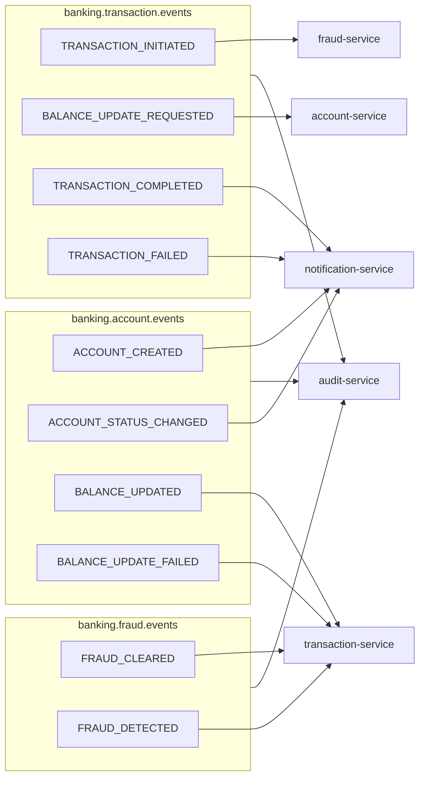

# Event-Driven Design

Services talk to each other through **events on Apache Kafka**. This document explains the event
model, conventions and guarantees. The full list of events is in the
[event catalog](../events/event-catalog.md).

## 1. Topics

| Topic | Owner (producer) | Events |
|-------|------------------|--------|
| `banking.account.events` | account-service | `ACCOUNT_CREATED`, `ACCOUNT_STATUS_CHANGED`, `BALANCE_UPDATED`, `BALANCE_UPDATE_FAILED` |
| `banking.transaction.events` | transaction-service | `TRANSACTION_INITIATED`, `BALANCE_UPDATE_REQUESTED`, `TRANSACTION_COMPLETED`, `TRANSACTION_FAILED` |
| `banking.fraud.events` | fraud-service | `FRAUD_CLEARED`, `FRAUD_DETECTED` |
| `banking.notification.events` | any service | `NOTIFICATION_REQUESTED` |

Every topic has a dead-letter topic with suffix `.DLT` (for example `banking.account.events.DLT`).
Topic names and the `EventType → topic` mapping live in `common-library` (`EventType`,
`EventType.Topics`). See [topic-design](../events/topic-design.md).

## 2. Event envelope

Every event extends `BaseEvent` and is sent as a **JSON string**:

| Field | Meaning |
|-------|---------|
| `eventId` | Unique id (UUID) for this event — used for idempotency |
| `eventType` | e.g. `TRANSACTION_INITIATED` — consumers dispatch on this |
| `aggregateId` | Id of the thing the event is about (account id, transaction id, recipient id). Also the Kafka **key** |
| `occurredAt` | ISO-8601 instant |
| `correlationId` | Ties all events of one business flow together (usually the transaction id or trace id) |
| `source` | Producing service name |
| `schemaVersion` | Integer version of the payload shape |

Business fields are added at the top level next to these.

## 3. Producer rules

- `StringSerializer` for key and value; the value is the Jackson-serialized event
  (`write-dates-as-timestamps: false`, so dates are ISO strings).
- `acks=all`, `enable.idempotence=true`.
- Producers declare `NewTopic` beans (3 partitions, replication factor 1) for the topics they own.
- account-service and transaction-service publish **only through the outbox**
  ([outbox-pattern](outbox-pattern.md)). fraud-service and notification-service publish directly.

## 4. Consumer rules

- `StringDeserializer`; parse into Jackson `JsonNode` (unknown fields ignored) and switch on
  `eventType`. Ignore event types you do not care about — several event types share one topic.
- **Idempotent**: before handling, check `processed_events(event_id PK, event_type, processed_at)`
  (or a unique business key, e.g. one balance update per `transactionId`). If already processed, skip.
  Insert the `processed_events` row in the same DB transaction as the business change.
- `ack-mode: record`, `auto-offset-reset: earliest`.
- Errors: `DefaultErrorHandler` with `FixedBackOff(1000L, 3)` — 3 retries, 1 second apart — then
  `DeadLetterPublishingRecoverer` sends the record to `<topic>.DLT`.
- Business failures (e.g. insufficient funds) are **not** errors: they produce a failure event
  (`BALANCE_UPDATE_FAILED`). Only unexpected problems (bad JSON, DB down) go to the DLT.

## 5. Who consumes what

## 6. Delivery guarantees

| Guarantee | How we get it |
|-----------|---------------|
| No lost events from account/transaction | Outbox in the same DB transaction |
| No duplicate side effects | Idempotent consumers (`processed_events`, unique keys) |
| Ordering per aggregate | Key = `aggregateId` → same partition |
| Poison messages don't block a partition | Retry 3x, then `.DLT` |
| Stuck flows get resolved | Saga timeout job (15 minutes) |

Kafka gives **at-least-once** delivery. Combined with idempotent consumers, the effect is
"exactly-once processing" from the business point of view.

Note on ordering: events for one *transaction* use the transaction id as key, so the saga steps for a
transaction are ordered. Account events use the account id. Events on different topics are not
ordered relative to each other; the saga orchestrator checks the current saga status before every
transition, so a late or duplicated reply is ignored safely.

## 7. Tracing an event flow

1. Take the transaction id (or `correlationId`).
2. `GET /api/v1/audit/logs/correlation/{correlationId}` (admin) shows every event of the flow in order.
3. Use the gateway `X-Trace-Id` to find the original HTTP request in logs.
