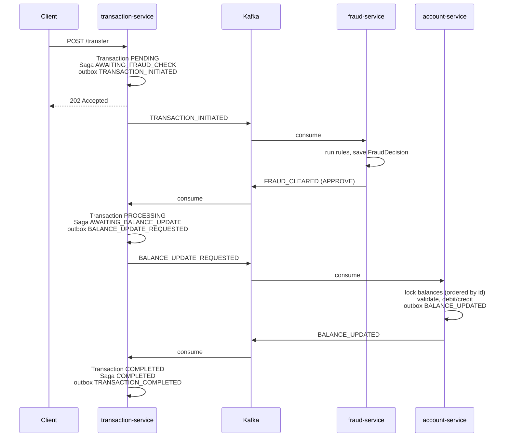
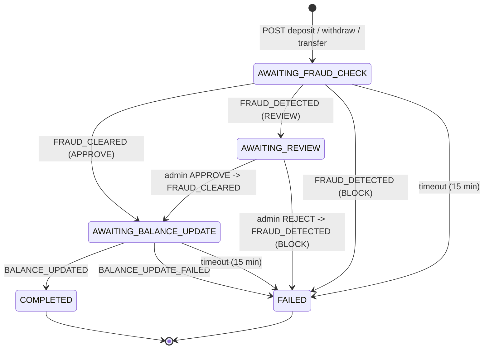

# Transaction Saga

Every deposit, withdrawal and transfer is a **saga** orchestrated by **transaction-service**.
Decision record: [ADR 0002](../adr/0002-saga-orchestration.md).

## 1. Participants

| Participant | Role in the saga |
|-------------|------------------|
| transaction-service | Orchestrator. Owns `Transaction` and `SagaState`. |
| fraud-service | Step 1: fraud check. Replies `FRAUD_CLEARED` / `FRAUD_DETECTED`. |
| account-service | Step 2: balance update. Replies `BALANCE_UPDATED` / `BALANCE_UPDATE_FAILED`. |
| fraud admin (human) | Optional: reviews alerts when the decision is REVIEW. |

## 2. Happy path

## 3. State machines

### Saga status

### Transaction status (what the customer sees)

| Saga status | Transaction status |
|-------------|--------------------|
| `AWAITING_FRAUD_CHECK` | `PENDING` |
| `AWAITING_REVIEW` | `UNDER_REVIEW` |
| `AWAITING_BALANCE_UPDATE` | `PROCESSING` |
| `COMPLETED` | `COMPLETED` |
| `FAILED` | `FAILED` |

Every transaction status change writes a status-history row
(`fromStatus`, `toStatus`, `reason`, `changedAt`) returned by `GET /api/v1/transactions/{id}/status`.

### Transition table

| Current saga status | Incoming | New saga status | Transaction | Outbox event |
|---------------------|----------|-----------------|-------------|--------------|
| – | REST request | `AWAITING_FRAUD_CHECK` | `PENDING` | `TRANSACTION_INITIATED` |
| `AWAITING_FRAUD_CHECK` / `AWAITING_REVIEW` | `FRAUD_CLEARED` | `AWAITING_BALANCE_UPDATE` | `PROCESSING` | `BALANCE_UPDATE_REQUESTED` |
| `AWAITING_FRAUD_CHECK` | `FRAUD_DETECTED` decision `REVIEW` | `AWAITING_REVIEW` | `UNDER_REVIEW` | – |
| `AWAITING_FRAUD_CHECK` / `AWAITING_REVIEW` | `FRAUD_DETECTED` decision `BLOCK` | `FAILED` | `FAILED` (`failureCode=FRAUD_BLOCKED`) | `TRANSACTION_FAILED` |
| `AWAITING_BALANCE_UPDATE` | `BALANCE_UPDATED` | `COMPLETED` | `COMPLETED` (`completedAt`) | `TRANSACTION_COMPLETED` |
| `AWAITING_BALANCE_UPDATE` | `BALANCE_UPDATE_FAILED` | `FAILED` | `FAILED` (`failureCode` from event) | `TRANSACTION_FAILED` |
| `AWAITING_FRAUD_CHECK` / `AWAITING_BALANCE_UPDATE` | timeout job | `FAILED` | `FAILED` (`failureCode=TRANSACTION_FAILED`, reason "Saga timed out") | `TRANSACTION_FAILED` |
| `COMPLETED` / `FAILED` | anything | unchanged | unchanged | – (ignored, logged) |

Any event that does not match the current state is ignored. This makes the orchestrator safe
against duplicates and late replies.

## 4. The balance step (account-service)

When account-service consumes `BALANCE_UPDATE_REQUESTED`, it does everything in **one DB transaction**:

1. Skip if this `transactionId` was already processed (idempotency).
2. Load the involved balances with a **pessimistic write lock** (`SELECT ... FOR UPDATE`), always in
   ascending account-id order so two opposite transfers cannot deadlock.
3. Validate: accounts exist, are `ACTIVE`, currency matches, the source account is owned by
   `initiatedBy` (for TRANSFER and WITHDRAWAL), and the source has enough **available** funds.
4. Debit source and/or credit destination.
5. Record the processed/ledger row for this `transactionId`.
6. Insert outbox `BALANCE_UPDATED` (with balances after) — or, on a business failure, make no balance
   change and insert `BALANCE_UPDATE_FAILED` with an `errorCode` such as `INSUFFICIENT_FUNDS`,
   `ACCOUNT_FROZEN`, `ACCOUNT_NOT_FOUND`, `CURRENCY_MISMATCH` or `FORBIDDEN`.

| Type | Source | Destination |
|------|--------|-------------|
| DEPOSIT | – | credit |
| WITHDRAWAL | debit | – |
| TRANSFER | debit | credit |

## 5. Compensation

Because the balance step is atomic, there is never a half-done money movement. So compensation is
simple: mark the transaction and saga `FAILED` and publish `TRANSACTION_FAILED` (which triggers a
customer notification and an audit entry). Nothing needs to be "undone".

If in future a step is added **after** the balance step (e.g. an external payment network), it would
need a real compensating action (`BALANCE_REVERSAL_REQUESTED`). That is out of scope today.

## 6. Timeouts

- Scheduled job in transaction-service; threshold `saga.timeout-minutes` (default `15`).
- Times out sagas in `AWAITING_FRAUD_CHECK` and `AWAITING_BALANCE_UPDATE` whose `updatedAt` is older
  than the threshold.
- `AWAITING_REVIEW` is **never** timed out: it waits for a human.
- Risk: if account-service applied the balance change but its `BALANCE_UPDATED` is still stuck in the
  outbox when the timeout fires, the transaction would be marked FAILED although money moved. The
  orchestrator ignores the late `BALANCE_UPDATED` (state is already FAILED) and logs a warning. This
  needs operator reconciliation — see [saga-stuck-recovery](../runbooks/saga-stuck-recovery.md).
  Keep the timeout well above normal outbox/consumer delays.

## 7. Admin view

`GET /api/v1/transactions/{id}/saga` (admin) returns `sagaId`, `transactionId`, `status`,
`currentStep`, `retryCount`, `failureReason`, `startedAt`, `updatedAt`, `completedAt`.
