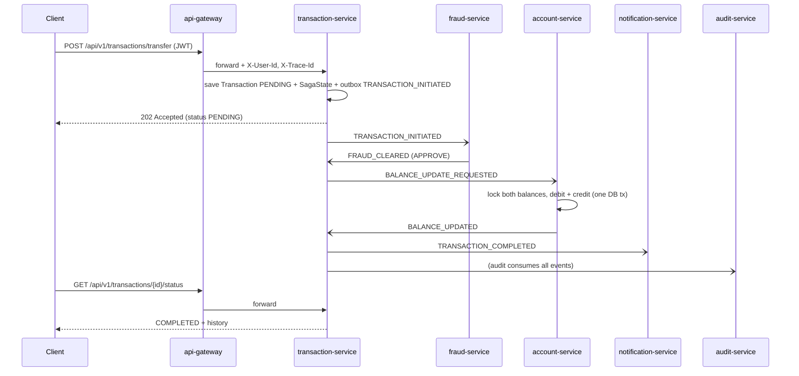

# System Overview

The Meridian banking platform is a set of Spring Boot microservices that let customers open accounts
and move money (deposit, withdraw, transfer), while every transaction is screened for fraud,
customers are notified and every event is audited.

## Big picture

```mermaid
flowchart LR
    UI[React frontend<br/>:5173] -->|REST + JWT| GW[api-gateway<br/>:8080]
    CLI[curl / Postman] -->|REST + JWT| GW

    GW --> ACC[account-service<br/>:8081]
    GW --> TXN[transaction-service<br/>:8082]
    GW --> FRD[fraud-service<br/>:8083]
    GW --> NTF[notification-service<br/>:8084]
    GW --> AUD[audit-service<br/>:8085]

    ACC --- ADB[(accounts_db)]
    TXN --- TDB[(transactions_db)]
    FRD --- FDB[(fraud_db)]
    NTF --- NDB[(notifications_db)]
    AUD --- AUDB[(audit_db)]

    ACC <-->|events| K{{Kafka}}
    TXN <-->|events| K
    FRD <-->|events| K
    NTF <-->|events| K
    AUD <--|events| K

    NTF -->|SMTP| MAIL[MailHog :1025]
```

ASCII version:

```
                    +----------------------+
  Browser / curl -->|  api-gateway :8080   |  login (JWT), routing, CORS,
                    |  (Spring Cloud GW)   |  circuit breakers, trace id
                    +----------+-----------+
                               | REST (Bearer JWT forwarded)
     +-----------+-----------+-+---------+--------------+-------------+
     v           v           v           v              v             |
 account     transaction   fraud     notification     audit           |
 :8081       :8082         :8083     :8084            :8085           |
   |  \         |  \         |  \       |   \            |   \        |
   | accounts_db| transactions_db fraud_db notifications_db audit_db   |
   |            |            |          |                 |            |
   +------------+------------+----------+-----------------+            |
                         Apache Kafka                                  |
   banking.account.events  banking.transaction.events                  |
   banking.fraud.events    banking.notification.events  (+ .DLT)       |
                                                                       |
   PostgreSQL :5432 (one instance, one database per service)           |
   Redis :6379, MailHog SMTP :1025, Prometheus/Grafana (observability) |
```

## Components

| Component | Port | Responsibility |
|-----------|------|----------------|
| api-gateway | 8080 | Single entry point. Issues JWTs (`/api/v1/auth/login`), validates them, routes to services, adds `X-User-Id`, `X-User-Roles`, `X-Trace-Id`, CORS, per-route circuit breaker, `/api/v1/system/health`. |
| account-service | 8081 | Accounts, status (ACTIVE/FROZEN/CLOSED), balances and holds. Applies debits/credits for the saga. Outbox publisher. |
| transaction-service | 8082 | Deposit/withdraw/transfer API, transaction history, **saga orchestrator**, saga timeout job. Outbox publisher. |
| fraud-service | 8083 | Rule-based scoring of every transaction, fraud alerts and admin review. |
| notification-service | 8084 | Sends email (SMTP/Thymeleaf), simulated SMS/push; retries failed sends. |
| audit-service | 8085 | Stores an immutable log of every account, transaction and fraud event. |
| common-library | – | Shared DTOs (`ApiResponse`, `ErrorResponse`, `PagedResponse`), `ErrorCode`, `BaseEvent`/`EventType`, JWT utilities, validators, base exception handler. |
| PostgreSQL | 5432 | One instance, databases `accounts_db`, `transactions_db`, `fraud_db`, `notifications_db`, `audit_db`. |
| Kafka | 9092 | Event backbone. |
| Redis | 6379 | Available to services (e.g. caching/rate limiting); health check disabled. |
| MailHog | 1025 (SMTP) | Catches outgoing email locally. |

## Request types

1. **Synchronous queries and commands** (REST): open account, list transactions, review alert.
   Browser → gateway → one service → its own database.
2. **Asynchronous money movement** (saga over Kafka): a transfer returns `202 Accepted` immediately;
   fraud check and balance update happen through events. See [saga-pattern](saga-pattern.md).
3. **Side effects** (Kafka consumers): notifications and audit react to events and never block the
   main flow. See [event-driven-design](event-driven-design.md).

## End-to-end: a transfer



## Cross-cutting concerns

- **Security** — JWT issued by the gateway and re-validated in every service. See
  [security-model](../security/security-model.md).
- **Reliability** — outbox, idempotent consumers, DLTs, saga timeouts. See
  [outbox-pattern](outbox-pattern.md).
- **Observability** — Actuator `health`, `info`, `metrics`, `prometheus` on every service;
  `X-Trace-Id` and event `correlationId` tie logs together. Tracing is optional
  (`TRACING_ENABLED=false` by default).
- **Errors** — every service extends `BaseGlobalExceptionHandler`, so errors look the same everywhere:

```json
{
  "error": {
    "message": "Insufficient funds",
    "code": "INSUFFICIENT_FUNDS",
    "status": 409,
    "timestamp": "2026-11-21T10:15:30Z"
  }
}
```

(The HTTP status comes from the `ErrorCode` enum in common-library.)

## Related documents

- [microservices-design](microservices-design.md)
- [event-driven-design](event-driven-design.md)
- [outbox-pattern](outbox-pattern.md)
- [saga-pattern](saga-pattern.md)
- [ADRs](../adr/README.md)
